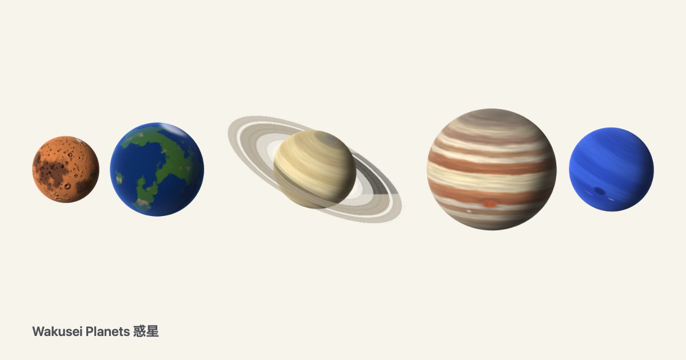
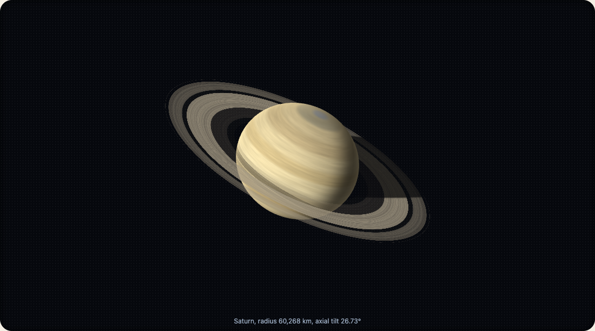
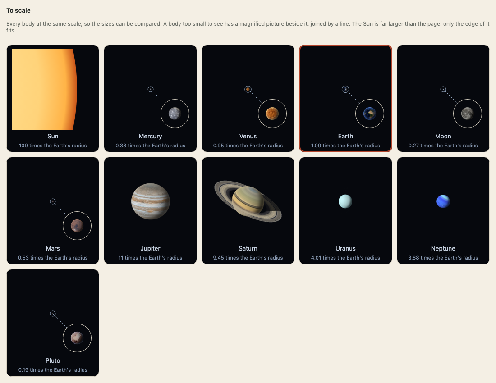
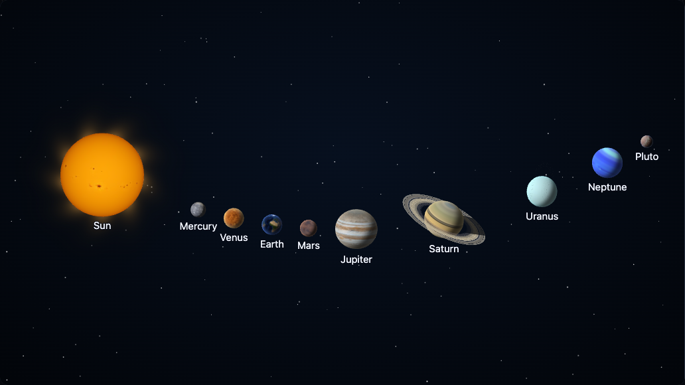

<p align="center"><a href="https://johnmorrisdotca.github.io/wakusei-planets/"><picture><source media="(prefers-color-scheme: dark)" srcset="https://raw.githubusercontent.com/johnmorrisdotca/wakusei-planets/main/docs/images/thumbnail-dark.png"></picture></a></p>

<h1 align="center">Wakusei Planets <sub>惑星</sub></h1>

<p align="center"><strong>The Sun, the planets and their moons, for the web.</strong><br>
A clean line drawing, a shaded realistic drawing, or a painted surface map, with each body's real size, axial tilt and rotation as data, and a planet's moons where they are at any date and time.</p>

<p align="center">
  <a href="https://github.com/johnmorrisdotca/wakusei-planets/actions/workflows/ci.yml"></a>
  <a href="./LICENSE"></a>
  
</p>

<p align="center"><a href="https://johnmorrisdotca.github.io/wakusei-planets/"><strong>Open the demo →</strong></a> · <a href="https://johnmorrisdotca.github.io/wakusei-planets/embed.html">Embed page</a> · <a href="https://johnmorrisdotca.github.io/wakusei-planets/docs/">Docs</a></p>

<p align="center"></p>

<p align="center"></p>

## One minute

```sh
npm install @johnmorrisdotca/wakusei-planets
```

A page with no build step needs one tag. `look="line"` is an SVG and needs nothing else:

```html
<!doctype html>
<html lang="en">
  <head>
    <meta charset="utf-8" />
    <meta name="viewport" content="width=device-width, initial-scale=1" />
    <title>Wakusei Planets from jsDelivr</title>
    <script type="module" src="https://cdn.jsdelivr.net/npm/@johnmorrisdotca/wakusei-planets/element/+esm"></script>
  </head>
  <body>
    <wakusei-body body="saturn" look="line" size="320"></wakusei-body>
  </body>
</html>
```

The same tag with the shared [kazoku-ui](https://github.com/johnmorrisdotca/kazoku-ui) controls, which turn, tip, zoom and pan the body:

```html
<!doctype html>
<html lang="en">
  <head>
    <meta charset="utf-8" />
    <meta name="viewport" content="width=device-width, initial-scale=1" />
    <title>Wakusei Planets with the shared controls</title>
    <script type="module">
      import "https://cdn.jsdelivr.net/npm/@johnmorrisdotca/kazoku-ui/view-controls/define/+esm";
      import "https://cdn.jsdelivr.net/npm/@johnmorrisdotca/wakusei-planets/element/+esm";

      const body = document.querySelector("wakusei-body");
      document.querySelector("kazoku-view-controls").addEventListener("kazoku-viewchange", (event) => {
        body.setView(event.detail);
      });
    </script>
  </head>
  <body>
    <div id="view" tabindex="0">
      <wakusei-body body="saturn" look="line" size="420"></wakusei-body>
    </div>
    <kazoku-view-controls for="view" address controls="advanced" tilt-max="90" speed="0"></kazoku-view-controls>
  </body>
</html>
```

A bundled app imports it: `import "@johnmorrisdotca/wakusei-planets/element"` (and `import { lineSvg } from "@johnmorrisdotca/wakusei-planets"` for the SVG string, which needs no browser). For the shaded look add the body's own entry point, `import "@johnmorrisdotca/wakusei-planets/jupiter"`, and `three` (an optional peer).

## Who it is for

- **A developer who wants a planet on a page** with one tag, no build step, and a drawing that is an SVG before any 3D has loaded.
- **A teacher, writer or museum** who needs the Sun, the planets and their moons at their real sizes and tilts, with every number traceable to the IAU, NASA or JPL.
- **A maker of sky tools** who wants a planet's pole, phase, ring opening and its moons' places for any date and time as plain data, on a server or in a browser.
- **A three.js developer** who wants the bodies as objects for a scene of their own.

## Features

- The Sun, the eight planets, Pluto, eight more dwarf planets and 29 moons, each with its real size, flattening, axial tilt, pole and rotation as data.
- Three looks: a clean `line` drawing (an SVG string), a shaded `realistic` sphere worked out in a shader, and a `painted` surface map from public-domain imagery.
- The sky for any date and time: a body's pole, rotation, phase and ring opening as the Earth sees it, and a planet's moons where they are then.
- One WebGL context for the page, nothing drawn at rest, at most thirty frames a second, and everything freed when an element leaves.
- A pure side that runs on a server: `BODIES`, `apparent`, `system`, `orbitPath`, `portrait` and `lineSvg`.
- `embedCode` writes the code that puts a body in a page for HTML, a module, React, Vue, Angular, Svelte or an iframe.
- `painter.make` hands a body to a three.js scene of your own.
- Every guide in English and Japanese; the demo's words too.

## Use it in your project

```sh
npm install @johnmorrisdotca/wakusei-planets three
```

```ts no-run
import "@johnmorrisdotca/wakusei-planets/element";
import "@johnmorrisdotca/wakusei-planets/saturn";
```

Import the element once in client code, and the entry point of each body you draw in a shaded look (or `/all`). A line drawing needs neither `three` nor an entry point. [Bundlers](docs/guides/bundlers.md) and [Frameworks](docs/guides/frameworks.md) go through it.

## Three looks

| Look | What it is | Needs |
|---|---|---|
| `line` | A clean outline drawing with the body's key features: bands, craters, rings and their gaps, caps, the dark side dashed off. An SVG. | nothing |
| `realistic` | A shaded sphere drawn from the body's real colours and features, lit from the Sun's side, with the rings casting shadows. No pictures: the surface is worked out in a shader. | `three`, the body's entry point |
| `painted` | A real surface map from public-domain NASA, USGS and JPL imagery. Small pictures first (1.31 MB for all of them in the package), a sharper one fetched when you zoom in. | `three`, the body's entry point |

Every body has its real size relative to the others (`scale-to="jupiter"`), its axial tilt and its rotation. The Sun, Mercury, Venus, Mars, Jupiter, Saturn, Uranus, Neptune and Pluto are drawn, and so are the eight other dwarf planets (Ceres, Orcus, Haumea, Quaoar, Makemake, Gonggong, Eris and Sedna; Haumea and Quaoar as the long shapes they are, and Ceres with a painted map from Dawn) and 29 moons (the Moon, Phobos and Deimos, the four Galilean moons, Saturn's seven larger moons, Uranus's five, Proteus, Triton and Nereid, Charon, Nix and Hydra, and Vanth, Hiʻiaka, Namaka and Dysnomia, the moons of the dwarf planets whose orbits are published with a date). The Earth is drawn like the rest in the realistic and painted looks (NASA's Blue Marble), and its line look is [chikyu-earth](https://github.com/johnmorrisdotca/chikyu-earth)'s own globe: `import "@johnmorrisdotca/wakusei-planets/earth"` (it needs `@johnmorrisdotca/chikyu-earth` 0.10.0 or later installed). The painted looks cover the Sun, the planets from Mercury to Earth and Pluto, Ceres, the Moon, the four Galilean moons, Saturn's Mimas, Enceladus, Tethys, Dione, Rhea, Titan and Iapetus, Triton and Charon, and Saturn's rings are Cassini's own picture of them.

## As the Earth sees it

Give a body a `time` and it is drawn as the sky shows it then: its pole and rotation, how far the rings are open (Saturn's rings are edge-on in March 2025), the phase of the Moon or Venus, the Sun's direction.

```html
<wakusei-body body="saturn" look="realistic" time="2026-11-02T12:00:00Z"></wakusei-body>
```

## Every way to use it

| How | Where |
|---|---|
| A script tag from jsDelivr or unpkg, a shaded body from a CDN | [CDN guide](docs/guides/html-and-cdn.md) |
| An ES module in Vite or webpack, only the bodies you need | [bundlers guide](docs/guides/bundlers.md) |
| React, Vue, Svelte, Angular; Next.js, Nuxt, SvelteKit | [frameworks guide](docs/guides/frameworks.md) |
| An `<iframe>` of the embed page, no script of your own | [iframe guide](docs/guides/embed-in-an-iframe.md) |
| Set up a body in the demo and copy the code for HTML, React, Vue, Angular, Svelte or an iframe | [Put it in your page](docs/guides/put-it-in-your-page.md), or `embedCode()` |
| TypeScript types, an SVG string on a server, Node | [TypeScript and Node guide](docs/guides/typescript-and-node.md) |
| The looks, the entry points, one WebGL context | [looks and bodies](docs/guides/looks-and-bodies.md) |
| Moons where they are on a date, time that runs fast | [moons and time](docs/guides/moons-and-time.md) |
| Something does not appear | [troubleshooting](docs/guides/troubleshooting.md) |

The guides are also in Japanese (日本語), one language to a page: [docs/guides/ja/](docs/guides/ja/getting-started.md).

In React, with the browser-only import where a server render never reaches it:

```tsx
import { useEffect } from "react";

export function WakuseiBody({ body = "saturn", look = "line" }: { body?: string; look?: "line" | "realistic" }) {
  useEffect(() => {
    // The element needs a browser, so it is imported here, never at the top of the file: a server render never reaches an effect.
    void import("@johnmorrisdotca/wakusei-planets/element");
    void import("@johnmorrisdotca/wakusei-planets/all");
  }, []);
  return <wakusei-body body={body} look={look} />;
}
```

Vue, Svelte and Angular components, the Vite and webpack setups and an `<iframe>` are in the guides, each one built and opened in a browser by `pnpm test:usage`.

## Light by design

A page full of bodies stays light: one WebGL context for the page through kazoku-ui's shared renderer (the body in focus is live, the others are pictures), nothing drawn while nothing changes, at most thirty frames a second while it moves, a canvas held to 4096 pixels a side and six million pixels, everything freed when an element leaves, no drawing out of sight or in a hidden tab, a slower turn for a reader who prefers reduced motion (`turn="0"` is the only stop), and a lost WebGL context coming back by itself. The tests count draws, animation frames, contexts and GPU objects at rest and over many changes (`pnpm test:freeze`, and a soak with `pnpm test:soak`).

## The element

| Attribute | What it does | Default |
| --- | --- | --- |
| `body` | The body's name. | `earth` |
| `look` | `line`, `realistic` or `painted`. | `line` |
| `size` | The width in pixels. | `320` |
| `time` | `now` or an ISO date: the body as the Earth sees it then. Left out, a portrait. | portrait |
| `moons` | A planet with its moons on their orbits (with a date). | off |
| `rate` | Simulated seconds for each real second. | `1` |
| `turn` | A portrait turns this many degrees a second. | `0` |
| `tilt`, `pitch`, `phase`, `meridian` | A portrait's pose in degrees. | the body's own |
| `scale-to` | Draw to scale with another body. | fills its box |
| `live` | `always`, `hover` or `off`: when a shaded body takes the page's one WebGL context. | `always` |
| `lang` | `en` or `ja` for names and labels. | `en` |

The pure side has no DOM: `BODIES`, `apparent(id, time)`, `system(planet, time)`, `orbitPath`, `portrait` and `lineSvg(id, options)`.

## The data

Sizes, flattening, poles and rotation are the IAU's and NASA's; Mercury to Neptune are VSOP87B, cut down, and Pluto is a table fitted to Horizons; the Moon's are the lunar solution ELP2000-82B cut down; the other moons are fitted to JPL Horizons' positions, and every body is tested against Horizons ([accuracy](docs/guides/accuracy.md)). Nothing is fetched at run time by the line and shaded looks, which use no pictures. See [NOTICE.md](NOTICE.md).

## Examples

Every `ts` block in this README is type-checked and run against the package as npm packs it (`pnpm test:readme`).

```ts
import { BODIES, MOONS_OF, PLANET_IDS } from "@johnmorrisdotca/wakusei-planets";

BODIES.saturn.radiusKm; // 60268
PLANET_IDS.length; // 9
Object.values(MOONS_OF).flat().length; // 25
```

The planets' state as the Earth sees them on a date:

```ts
import { apparent } from "@johnmorrisdotca/wakusei-planets";

const saturn = apparent("saturn", Date.UTC(2026, 10, 2));
console.log(saturn.subObserverLat.toFixed(1), saturn.illumination.toFixed(2));
```

A planet's moons where they are on a date, as offsets from it in the planet's radii:

```ts
import { system } from "@johnmorrisdotca/wakusei-planets";

const { moons } = system("jupiter", Date.UTC(2026, 10, 2));
console.log(moons.map((moon) => `${moon.id} ${moon.x.toFixed(1)}`).join(", "));
```

A line drawing as an SVG string, with no browser:

```ts
import { lineSvg } from "@johnmorrisdotca/wakusei-planets";

const svg = lineSvg("mars", { size: 200, tilt: 15, lang: "ja" });
if (!svg.startsWith("<svg") || !svg.includes("火星")) throw new Error("not a Mars drawing");
```

The code that puts a body in a page, for any of the ways a page is made:

```ts
import { EMBED_KINDS, embedCode } from "@johnmorrisdotca/wakusei-planets";

for (const kind of EMBED_KINDS) console.log(kind, embedCode({ body: "mars", look: "line", size: 240 }, kind).split("\n")[0]);
```

A body for your own three.js scene, in the browser:

The moons' places on an orbit, as points for a line you draw yourself:

```ts
import { orbitPath } from "@johnmorrisdotca/wakusei-planets";

const path = orbitPath("io", Date.UTC(2026, 10, 2), 8);
console.log(path.length / 3, "points");
```

How much of the Moon is lit on a date:

```ts
import { apparent } from "@johnmorrisdotca/wakusei-planets";

const moon = apparent("moon", Date.UTC(2026, 10, 24, 14));
if (moon.illumination < 0.9) throw new Error("the Moon is nearly full on 24 November 2026");
```

A page that cannot run script uses an iframe of the embed page:

```html
<iframe src="https://johnmorrisdotca.github.io/wakusei-planets/embed.html?body=mars&look=line" title="Mars" width="320" height="320" style="border:0"></iframe>
```

```ts no-run
import * as THREE from "three";
import { painter } from "@johnmorrisdotca/wakusei-planets/painter";

const scene = new THREE.Scene();
const jupiter = painter.make(THREE, "Jupiter", { look: "realistic", invalidate: () => {}, ratio: 1 });
scene.add(jupiter.object);
```

A body that turns by itself and a moving sky, in HTML:

```html
<wakusei-body body="jupiter" look="line" moons time="now" rate="600" size="360"></wakusei-body>
<wakusei-body body="venus" look="realistic" time="2026-11-02T12:00:00Z" turn="12" live="hover"></wakusei-body>
```

## The code builder

[The code builder](https://johnmorrisdotca.github.io/wakusei-planets/builder.html) is one screen: choose which planet's system, the body, the look, the size, the sky and the turning, then pick how your page is made and copy the code. It is the family's embed panel with those choices inside it, built from `embedCode`, so it writes what the package writes. [Put it in your page](docs/guides/put-it-in-your-page.md) is its guide.

## The portrait builder

<p align="center"></p>

[The portrait builder](https://johnmorrisdotca.github.io/wakusei-planets/portrait.html) puts any bodies in one picture: drag them, size them, turn them, order them front to back, arrange them in a row, an arc, a grid or at true orbit distance (true or readable sizes, a planet's moons round it in orbit order), light them from one direction, and take the code, a PNG or an SVG. The scene is kept in the address, and every body is drawn in one WebGL scene, so the page holds one WebGL context. [The portrait builder](docs/guides/portrait-builder.md) is its guide.

```html
<script type="module" src="https://cdn.jsdelivr.net/npm/@johnmorrisdotca/wakusei-planets/portrait/+esm"></script>
<script type="module" src="https://cdn.jsdelivr.net/npm/@johnmorrisdotca/wakusei-planets/all/+esm"></script>

<wakusei-portrait scene="look:painted~jupiter_0_0_0.3_0~io_0_0_0.1_0"></wakusei-portrait>
```

## API

The reference is a site, made from the source's own doc comments: every export has a summary, its parameters, what it returns and an example that runs when the site is built. [Open the reference](https://johnmorrisdotca.github.io/wakusei-planets/docs/).

| Entry point | What it gives |
| --- | --- |
| `@johnmorrisdotca/wakusei-planets` | The pure side: `BODIES`, `apparent`, `system`, `orbitPath`, `portrait`, `lineSvg`, `embedCode`. No browser. |
| `.../element` | `<wakusei-body>`; three.js is loaded only for a shaded look. |
| `.../portrait` | `<wakusei-portrait>`: many bodies in one scene. The scene model (`addBody`, `layoutPortrait`, `encodeScene`, `decodeScene`) is in the main entry. |
| `.../look` | What a body needs to be drawn with three.js. |
| `.../painter` | The bodies as objects for a scene of your own. |
| `.../all` | Every body's shaded look, at once. |
| `.../saturn`, `.../jupiter` and the rest | One body's shaded look. `.../moons-jupiter` and its siblings: a planet's moons. |

```ts
import * as pure from "@johnmorrisdotca/wakusei-planets";

console.log(Object.keys(pure).sort().join(", "));
```

## Guides

Each guide has a Japanese twin in [docs/guides/ja](docs/guides/ja/getting-started.md).

| Guide | What it is for |
| --- | --- |
| [Getting started](docs/guides/getting-started.md) | A body on a page |
| [HTML and CDN](docs/guides/html-and-cdn.md) | A script tag from jsDelivr or unpkg |
| [Bundlers](docs/guides/bundlers.md) | Vite and webpack, only the bodies you need |
| [Frameworks](docs/guides/frameworks.md) | React, Vue, Svelte, Angular |
| [Embed in an iframe](docs/guides/embed-in-an-iframe.md) | No script of your own |
| [Put it in your page](docs/guides/put-it-in-your-page.md) | Set up a body and copy the code |
| [The portrait builder](docs/guides/portrait-builder.md) | Many bodies in one picture |
| [Looks and bodies](docs/guides/looks-and-bodies.md) | The looks and each body's entry point |
| [Moons and time](docs/guides/moons-and-time.md) | The sky on a date, time that runs fast |
| [Accuracy](docs/guides/accuracy.md) | How far each body is from JPL Horizons |
| [In your own three.js scene](docs/guides/in-your-own-scene.md) | `painter.make` |
| [Time](docs/guides/time.md) | Julian dates, calendars, time scales, sidereal time, Mars time |
| [The stars you can see without a telescope](docs/guides/stars.md) | 5,080 stars with names, positions, proper motion, distance and colour |
| [The Sun and Moon from a place](docs/guides/suncalc.md) | Position, sunrise and sunset, Moon rise, set and phase; a drop-in for suncalc |
| [Coordinate conversions](docs/guides/coordinates.md) | Pure spherical, ecliptic, equatorial and horizontal coordinate conversions |
| [TypeScript and Node](docs/guides/typescript-and-node.md) | Types and the pure side |
| [How it works](docs/guides/how-it-works.md) | Where the numbers come from |
| [Architecture](docs/guides/architecture.md) | How the layers fit |
| [Troubleshooting](docs/guides/troubleshooting.md) | Something does not appear |
| [Upgrading](docs/guides/upgrading.md) | What to act on between versions |

## Limits

```ts
import { BODIES } from "@johnmorrisdotca/wakusei-planets";

BODIES.pluto.kind; // "dwarf-planet"
```

- A fact with no source is left out, never guessed. The Moon is within 2 arc-seconds of JPL Horizons, and the other moons' positions are fitted to it and are within a degree or two on the orbit for almost every moon, about the size of the moon on screen; [accuracy](docs/guides/accuracy.md) has each body's number.
- `realistic` and `painted` are the photo maps (`painted` is the same maps, so an older page still works). `illustrated` is the shaded drawing from the numbers, and it is not a default. Venus, Saturn, Neptune and the Sun use Solar System Scope's maps (CC BY 4.0). Mercury uses the natural grey 8K map (Shady Tex and Solar System Scope, CC BY 4.0). Mars stays on the Viking mosaic, graded toward a butterscotch ochre, with the frost in Hellas toned to the basin and the polar ice left. Jupiter and Uranus use Nestaeric's maps (CC BY 4.0), and Saturn's poles use Nestaeric's caps (CC BY 4.0). The Earth and the Moon stay on their NASA maps until those have been compared. The rest are the public-domain maps in `NOTICE.md`.
- A shaded look needs WebGL. Without it the line drawing is drawn.
- Jupiter, Saturn, Uranus and Neptune have their rings drawn.
- A portrait with no `turn` turns at 12 degrees a second, backwards when the body turns backwards. A picture with a date keeps that orientation and adds the same turn. `turn="0"` stays still.
- Pictures for the painted look are 1.31 MB in the package at 512 and 1024 pixels; a sharper picture is fetched when you zoom in.

## Accessibility

- Every `<wakusei-body>` is an image with an accessible name from its body and look, such as "Saturn, line drawing", or the Japanese name with `lang="ja"`.
- A reader who prefers reduced motion gets a quarter of the turn. `turn="0"` is the only stop.
- A body can be turned, tipped, zoomed and panned with the keyboard, and the view controls are at least 48 pixels.
- Names and labels are in English and Japanese (`lang="ja"`).

```html
<wakusei-body body="saturn" look="line" lang="ja" size="320"></wakusei-body>
```

## Browser and runtime support

- The package needs Node 24 or later. The pure side runs in Node and in any current browser; the element needs a current browser.
- The shaded looks need WebGL and `three` `>=0.160.0` (an optional peer).
- The tests run the demo in Chromium and WebKit, at a phone's width and a desk's, and draw WebGL in software.

## Languages

The names and labels in the element are in English and Japanese (`lang`), and so are the demo's words and every guide: each guide in [docs/guides](docs/guides) has a twin in [docs/guides/ja](docs/guides/ja/getting-started.md), one language to a page.

```ts
import { lineSvg } from "@johnmorrisdotca/wakusei-planets";

console.log(lineSvg("saturn", { size: 160, lang: "ja" }).includes("土星"));
```

Japanese names and labels need only the `lang` attribute; the SVG string takes the same option.

## Architecture

The lowest layers are pure and import with no browser: the facts, the positions, the pose and the line drawing. The shaded looks are one entry point for each body, registered by name, and every `<wakusei-body>` shares one WebGL context through kazoku-ui. [Architecture](docs/guides/architecture.md) has the layers.

```ts
import { portrait } from "@johnmorrisdotca/wakusei-planets";

const pose = portrait("uranus");
console.log(pose.pole.length);
```

## Development

```sh
pnpm install
pnpm check         # lint, types, unit tests, the build and the packed package
pnpm test:readme   # every ts block of the README, type-checked and run against the packed package
pnpm test:usage    # every way of using it in the README and the guides, built and opened
pnpm docs:check    # the reference site's checks
pnpm test:demo     # the demo and the docs site in a real browser
pnpm dev           # the demo on http://127.0.0.1:8225/wakusei-planets/
```

The pictures in `docs/images` are made by the package's own script:

```sh
ONLY=hero-saturn-painted,builder-desk pnpm screenshots
```

## Contributing

Work in a git worktree from `origin/main`, one branch per change:

```sh
git worktree add ../wakusei-work -b my-change origin/main
```

See [CONTRIBUTING.md](CONTRIBUTING.md). The rules that matter most: draw from public facts and cite them, pictures only from public-domain sources, a fact with no source is left out, and performance is not optional.

## Changes

[CHANGELOG.md](CHANGELOG.md) lists every release with its date.

## Licence

MIT: see [LICENSE](LICENSE). The code is MIT. Some pictures are CC BY 4.0 (Solar System Scope, and Nestaeric for Jupiter, Uranus and Saturn's poles) and the rest are public-domain NASA, USGS and JPL imagery. Each file is credited in [NOTICE.md](NOTICE.md).

## The name

Wakusei (惑星, わくせい) is Japanese for a planet.

## The family

<!-- family:start (made by scripts/family-readme.mjs from scripts/family-template.mjs; change those, not this) -->
Wakusei Planets is one of thirty-four packages, each made for the same site, each at
[github.com/johnmorrisdotca](https://github.com/johnmorrisdotca) or [github.com/spxis](https://github.com/spxis). The code of every one is MIT.

**Games — board**

- [Domino](https://github.com/johnmorrisdotca/domino) (ドミノ): dominoes and Mexican Train. [Demo](https://johnmorrisdotca.github.io/domino/).
- [Gunjin](https://github.com/johnmorrisdotca/gunjin) (軍人): five hidden-rank strategy games with pass-the-device play. [Demo](https://johnmorrisdotca.github.io/gunjin/).
- [Narabe](https://github.com/johnmorrisdotca/narabe) (並べ): one rules engine for abstract board games, from gomoku and Reversi to Go and checkers. [Demo](https://johnmorrisdotca.github.io/narabe/).
- [Sugoroku](https://github.com/johnmorrisdotca/sugoroku) (双六): backgammon and its variants, with the doubling cube and match play. [Demo](https://johnmorrisdotca.github.io/sugoroku/).
- [Tenka](https://github.com/johnmorrisdotca/tenka) (天下): world conquest for two to six, on a map of the real world. [Demo](https://johnmorrisdotca.github.io/tenka/).

**Games — cards & tiles**

- [Hitotsu](https://github.com/johnmorrisdotca/hitotsu) (一つ): a colour-card shedding game for two to eight, with the house rules people play. [Demo](https://johnmorrisdotca.github.io/hitotsu/).
- [Jarajara](https://github.com/johnmorrisdotca/jarajara) (ジャラジャラ): mahjong tiles drawn as SVG, stacked layouts, and the matching solitaire Awase. [Demo](https://johnmorrisdotca.github.io/jarajara/).
- [Kumimoji](https://github.com/johnmorrisdotca/kumimoji) (組み文字): a crossword tile race, in English and Japanese kana. [Demo](https://johnmorrisdotca.github.io/kumimoji/).
- [Toranpu](https://github.com/johnmorrisdotca/toranpu) (トランプ): a deck of playing cards, card games with computer players, and solitaires. [Demo](https://johnmorrisdotca.github.io/toranpu/).

**Games — puzzles**

- [Houseki](https://github.com/johnmorrisdotca/houseki) (宝石): gem and stone matching puzzles: falling triplets, stone collapse, colour chains and gem swap. [Demo](https://johnmorrisdotca.github.io/houseki/).
- [Jirai](https://github.com/johnmorrisdotca/jirai) (地雷): minesweeper on shaped grids with verified no-guess boards. [Demo](https://johnmorrisdotca.github.io/jirai/).
- [Karakuri](https://github.com/johnmorrisdotca/karakuri) (からくり): eight hyper-casual puzzle games, some of them physics: draw a shield, pull pins, cut ropes, slide blocks, pour tubes. [Demo](https://johnmorrisdotca.github.io/karakuri/).
- [Kazu](https://github.com/johnmorrisdotca/kazu) (数): grid number puzzles: Sudoku and its variants, Futoshiki and Skyscrapers. [Demo](https://johnmorrisdotca.github.io/kazu/).
- [Kyuubu](https://github.com/johnmorrisdotca/kyuubu) (キューブ): a turning cube for the browser, 2×2 to 7×7, with record solves to replay. [Demo](https://johnmorrisdotca.github.io/kyuubu/).
- [Meikyuu](https://github.com/johnmorrisdotca/meikyuu) (迷宮): mazes on squares, hexagons, triangles and circles, made from a seed and drawn through with a finger or the mouse. [Demo](https://johnmorrisdotca.github.io/meikyuu/).
- [Suido](https://github.com/johnmorrisdotca/suido) (水道): a pipe puzzle: turn the pieces until the water reaches every drain. [Demo](https://johnmorrisdotca.github.io/suido/).
- [Tobiishi](https://github.com/johnmorrisdotca/tobiishi) (飛び石): peg solitaire with nine boards and seeded solvable challenges. [Demo](https://johnmorrisdotca.github.io/tobiishi/).
- [Tsunagi](https://github.com/johnmorrisdotca/tsunagi) (繋ぎ): a line-joining logic puzzle whose every level has exactly one answer. [Demo](https://johnmorrisdotca.github.io/tsunagi/).

**Games — dice & random**

- [Korokoro](https://github.com/johnmorrisdotca/korokoro) (コロコロ): dice, with notation, exact odds, real sounds and the dice of many games. [Demo](https://johnmorrisdotca.github.io/korokoro/).
- [Tane](https://github.com/johnmorrisdotca/tane) (種): seeded random numbers and daily seeds, the same in every browser and on every server. [Demo](https://johnmorrisdotca.github.io/tane/).

**Language**

- [Bushu](https://github.com/johnmorrisdotca/bushu) (部首): find a kanji by the parts it is made of. [Demo](https://johnmorrisdotca.github.io/bushu/).
- [Hikidashi](https://github.com/johnmorrisdotca/hikidashi) (引き出し): a drawer of small Japanese text tools: era dates, kanji numerals, readings and sentence difficulty. [Demo](https://johnmorrisdotca.github.io/hikidashi/).
- [Kotoba](https://github.com/johnmorrisdotca/kotoba) (言葉): word lists and word-game rules in English, French, German and Japanese. [Demo](https://johnmorrisdotca.github.io/kotoba/).

**Geography & data**

- [address-plus](https://github.com/johnmorrisdotca/address-plus) (アドレスプラス): parse and format addresses in the United States, Canada, Japan, Australia, France, Germany and the United Kingdom. [Demo](https://johnmorrisdotca.github.io/address-plus/).
- [Chikyu Earth](https://github.com/johnmorrisdotca/chikyu-earth) (地球): a line-drawn globe that turns at the Earth's own rate, with an optional realistic Earth from space and markers for any place. [Demo](https://johnmorrisdotca.github.io/chikyu-earth/).
- [Chizu](https://github.com/johnmorrisdotca/chizu) (地図): maps of the world and of countries' regions, in English and Japanese, with a quiz and callouts. [Demo](https://johnmorrisdotca.github.io/chizu/).
- [Hata](https://github.com/johnmorrisdotca/hata) (旗): country and regional flags as SVG, at their true proportions and keyed by ISO code. [Demo](https://johnmorrisdotca.github.io/hata/).
- [Kuni](https://github.com/johnmorrisdotca/kuni) (国): countries and their regions, with ISO codes and names in English and Japanese. [Demo](https://johnmorrisdotca.github.io/kuni/).
- [Wakusei Planets](https://github.com/johnmorrisdotca/wakusei-planets) (惑星): the Sun, the planets and their moons, as line drawings, shaded drawings and painted surface maps, with their real sizes, tilt and rotation. [Demo](https://johnmorrisdotca.github.io/wakusei-planets/).

**Sports**

- [Dougu Sports](https://github.com/johnmorrisdotca/dougu-sports) (道具): sports emblems as SVG: trophies, medals, crests, and the ball and gear of every sport, with optional 3D turning. [Demo](https://johnmorrisdotca.github.io/dougu-sports/).
- [Kyogijo Stadiums](https://github.com/johnmorrisdotca/kyogijo-stadiums) (競技場): sports fields, rinks, courts and ballparks drawn to scale as SVG, with each team and the score on them. [Demo](https://johnmorrisdotca.github.io/kyogijo-stadiums/).
- [Senshu Jerseys](https://github.com/johnmorrisdotca/senshu-jerseys) (選手): sports jerseys, sweaters, kits, caps, helmets and retired-number banners as SVG, front and back, with optional 2.5D turning. [Demo](https://johnmorrisdotca.github.io/senshu-jerseys/).
- [Taisen Brackets](https://github.com/johnmorrisdotca/taisen-brackets) (対戦): a sport-agnostic tournament bracket, drawn as SVG, from a list of ties. [Demo](https://johnmorrisdotca.github.io/taisen-brackets/).

**Developer tools**

- [REST in Pieces](https://github.com/spxis/rest-in-pieces) (レスト・イン・ピーシーズ): seeded test data and REST APIs for frontend development, with latency and error drills. [Demo](https://spxis.github.io/rest-in-pieces/).


**This package is Wakusei Planets.** The demos of all thirty-four share one header and footer, so each links the rest.
<!-- family:end -->
