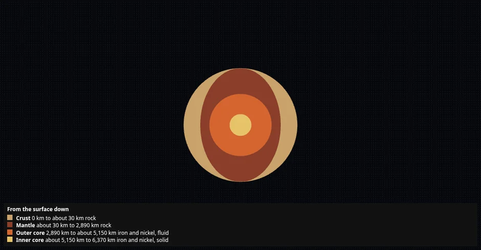
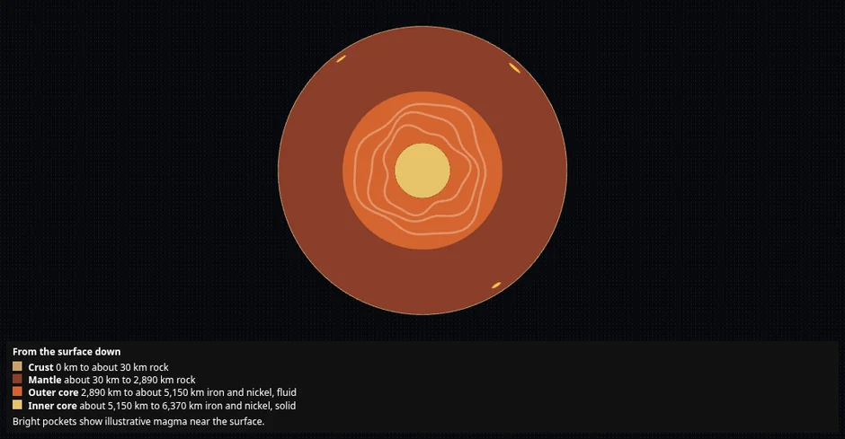
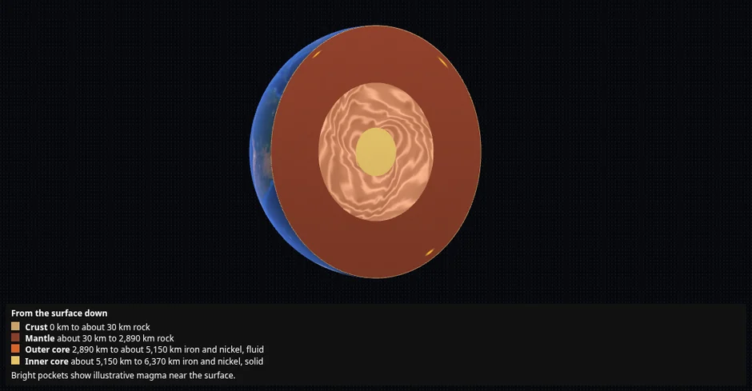
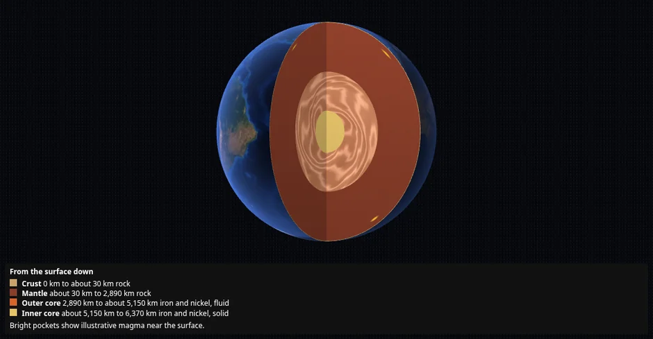

Cutaways are off until requested. Leave off the attribute or set `cutaway="off"` for a whole body. The legend gives the layer names, their composition, and depth from the surface in kilometres to three significant figures.

The examples assume you have imported `@johnmorrisdotca/wakusei-planets/element`. For a shaded Earth, also import `@johnmorrisdotca/wakusei-planets/earth` and install `three`. See [Looks and bodies](looks-and-bodies.md).

## Classic cutaway

Add the bare `cutaway` attribute to open a quarter of the globe in the classic nested-shell view. True spherical shells keep their rims concentric as the globe turns. The Sun uses whole discs. On phones, the layer legend goes below the globe.

```html
<wakusei-body body="earth" look="realistic" cutaway></wakusei-body>
```



## 2D cross-section

Use the line look with either explicit cut size to draw a flat cross-section showing the complete rings. This view runs without WebGL and also serves as the fallback for an explicit cut if WebGL fails. The legend goes below the cross-section on phones.

```html
<wakusei-body body="earth" look="line" cutaway="quarter"></wakusei-body>
```



## 3D half cutaway

Use `half` to open 180° around the globe’s vertical axis. The filled face stays toward you as you rotate the globe. On phones, the globe and the full face fit above the legend.

```html
<wakusei-body body="earth" look="realistic" cutaway="half"></wakusei-body>
```



## 3D quarter cutaway

Use `quarter` to remove a 90° wedge and see its two filled faces. Turn the globe to inspect its surface while the opening stays toward you. On phones, both faces fit above the legend.

```html
<wakusei-body body="earth" look="realistic" cutaway="quarter"></wakusei-body>
```


## Animate the cutaway

Add `cutaway-flow` to an explicit cut to animate the liquid outer core of Earth or the Moon, or the metallic hydrogen in Jupiter. You can use it in 2D as well. The bright spots near Earth’s surface illustrate local magma pockets. On phones and desktop, the demo’s **Play flow** and **Pause flow** buttons sit above the view. In your own page, remove the attribute to pause. Flow pauses when the body leaves the viewport or the tab is hidden, and the view stays still when reduced motion is on.

```html
<wakusei-body body="earth" look="realistic" cutaway="quarter" cutaway-flow></wakusei-body>
```



## Available cutaways

Layer proportions follow the sources below. “About” marks an approximate boundary. The classic view of the Sun uses discs.

| Body | Views | Source | Schematic proportions |
|---|---|---|---|
| Earth | Classic, 2D, ½, ¼ | [NASA Earth Fact Sheet][earth-sheet] and [NASA Science Earth Facts][earth-facts] | No |
| Mars | Classic, 2D, ½, ¼ | [NASA Mars Fact Sheet][mars-sheet] | No |
| Moon | Classic, 2D, ½, ¼ | [NASA Moon Fact Sheet][moon-sheet] and [NASA Science Moon Facts][moon-facts] | No |
| Mercury | Classic, 2D, ½, ¼ | [NASA Mercury Fact Sheet][mercury-sheet] and [NASA Science Mercury Facts][mercury-facts] | No |
| Sun | Classic, 2D, ½, ¼ | [NASA Sun Fact Sheet][sun-sheet] and [NASA Science Sun Facts][sun-facts], with the convection boundary from [corrected Model S][sun-model] | No |
| Jupiter | Classic, 2D, ½, ¼ | [NASA Jupiter Fact Sheet][jupiter-sheet] and [Militzer et al. (2022), model A][jupiter-model] | No |
| Saturn | Classic, 2D, ½, ¼ | [NASA Saturn Fact Sheet][saturn-sheet], [NASA Science Saturn Facts][saturn-facts] and [Mankovich and Fuller (2021)][saturn-model] | No |
| Venus | Classic, 2D, ½, ¼ | [Margot et al. (2021), two-layer model][venus-model] | No |
| Uranus | Classic, 2D, ½, ¼ | [Nettelmann et al. (2013), model U2][ice-giant-model] | No |
| Neptune | Classic, 2D, ½, ¼ | [Nettelmann et al. (2013), model N2b][ice-giant-model] | No |

Bodies below stay whole because the package has no adopted source with their layer boundaries. When a cut is requested, the legend reports this. The NASA fact sheets consulted for Io, Europa, Ganymede and Titan give no layer boundary figures.

| Body | Views | Layer source | Schematic proportions |
|---|---|---|---|
| Pluto, Ceres, Orcus, Haumea, Quaoar, Makemake, Gonggong, Eris, Sedna | Whole | — | — |
| Bennu, Eros, Vesta, Pallas, Arrokoth | Whole | — | — |
| Chiron, Pholus | Whole | — | — |
| Halley | Whole | — | — |
| Phobos, Deimos | Whole | — | — |
| Io, Europa, Ganymede, Callisto, Amalthea, Thebe | Whole | — | — |
| Mimas, Enceladus, Tethys, Dione, Rhea, Titan, Iapetus, Hyperion, Phoebe, Janus, Epimetheus, Prometheus, Pandora, Atlas, Pan, Daphnis, Helene, Telesto, Calypso | Whole | — | — |
| Miranda, Ariel, Umbriel, Titania, Oberon | Whole | — | — |
| Proteus, Larissa, Triton, Nereid | Whole | — | — |
| Charon, Nix, Hydra, Styx, Kerberos | Whole | — | — |
| Vanth | Whole | — | — |
| Hiʻiaka, Namaka | Whole | — | — |
| Dysnomia | Whole | — | — |

Use `interiorOf("earth")` to read the same layers the legend uses. [NOTICE.md](../../NOTICE.md) lists the sources and access dates.

## Named stellar models

On the Star page, pick an **Interior model**, then choose **¼ cutaway** or **½ cutaway**. The legend gives radii from the centre, mass, age, initial composition and a link to the saved profile. Each example represents one stage of the model's evolution. A star made with custom numbers keeps its whole view.

| `star` value | Model |
| --- | --- |
| `mesa-red-dwarf` | A fully convective 0.20-solar-mass red dwarf at the start of the main sequence |
| `mesa-massive-zams` | A 20-solar-mass main-sequence star with a convective core |
| `mesa-giant-tip` | A red giant at helium ignition. Beside it, an inset uses its own scale to show the core and burning shell from 0 to about 22,100 km, the inner 0.018% of the full radius. |
| `mesa-hot-white-dwarf` | A 0.61-solar-mass hot white dwarf with hydrogen-rich and helium-rich layers over a carbon–oxygen core |

```html
<wakusei-body star="mesa-giant-tip" cutaway="quarter" look="realistic"></wakusei-body>
```

Set `look="line"` for the concentric cross-section. The embed controls on the Star page carry the selected model and cut into their generated code. [Profile credits and extraction](../../NOTICE.md#named-stellar-cutaways)

## The Earth

The volumetric mean radius is 6371 km and the core's outside is 3485 km (NASA Earth Fact Sheet, read 2026-11-13). The inner core is about 1221 km in radius, iron and nickel, solid. The outer core is iron and nickel, fluid. The crust is rock, about 30 km deep on land. The mantle is the rock between the core and that crust, so its outside is the mean radius minus about 30 km. The page also says the ocean crust is about 5 km; this cutaway draws the land figure as the one crust.

| Layer | Depth from the surface | Made of |
|---|---|---|
| Crust | 0 km to about 30 km | rock |
| Mantle | about 30 km to 2,890 km | rock |
| Outer core | 2,890 km to about 5,150 km | iron and nickel, fluid |
| Inner core | about 5,150 km to 6,370 km | iron and nickel, solid |

## Mars

The volumetric mean radius is 3389.5 km and the core's radius is 1830 km (NASA Mars Fact Sheet, read 2026-11-13). The page does not say what either part is made of, and it does not split the outside of the core, so the legend says "not stated" and draws two layers.

| Layer | Depth from the surface | Made of |
|---|---|---|
| Outside the core | 0 km to 1,560 km | not stated |
| Core | 1,560 km to 3,390 km | not stated |

## The Moon

The volumetric mean radius is 1737.4 km (NASA Moon Fact Sheet). The layers are NASA Science's Moon facts, read 2026-11-26: a solid iron-rich inner core 240 km in radius, a liquid iron shell 90 km thick (drawn at 330 km), and a near-side crust about 40 km thick. The far side is up to about 60 km, and that is not the crust drawn. The page names a partly molten layer and gives it no thickness, so it is not its own shell. The mantle is what the page says is most likely olivine and pyroxene.

| Layer | Depth from the surface | Made of |
|---|---|---|
| Crust | 0 km to about 40 km | rock |
| Mantle | about 40 km to 1,410 km | olivine and pyroxene |
| Outer core | 1,410 km to 1,500 km | iron, liquid |
| Inner core | 1,500 km to 1,740 km | iron, solid |

## Mercury

The volumetric mean radius is 2439.7 km (NASA Mercury Fact Sheet). NASA Science's Mercury facts, read 2026-11-26, give a metallic core about 2,074 km in radius, partly molten, and call the rest a rocky mantle and a crust without splitting them. The same page also says that shell is about 400 km thick. This cutaway uses the stated core radius and the fact-sheet radius, so the shell it draws is 365.7 km.

| Layer | Depth from the surface | Made of |
|---|---|---|
| Mantle and crust | 0 km to about 366 km | rock |
| Core | about 366 km to 2,440 km | metal, partly molten |

## The Sun

NASA gives the volumetric mean radius as 695,700 km and a core about 138,000 km thick. The base of convection is at 0.7127 of the radius in the corrected Model S. The cutaway places that fraction on the NASA radius, with the radiative zone between the core and the convection zone. [NASA Sun Fact Sheet][sun-sheet], [NASA Science Sun Facts][sun-facts], [Model S author data][sun-model].

| Layer | Depth from the surface | Made of |
|---|---|---|
| Convection zone | 0 km to about 200,000 km | Hydrogen and helium |
| Radiative zone | About 200,000 km to about 558,000 km | Hydrogen and helium |
| Core | About 558,000 km to 696,000 km | Hydrogen fusing into helium |

## Jupiter

Militzer and others, 2022, "Juno Spacecraft Measurements of Jupiter's Gravity Imply a Dilute Core" (Planet. Sci. J., doi 10.3847/PSJ/ac7ec8), model A, read 2026-11-26. An ensemble of that model puts the inner edge of the transition at 0.41 of the radius, give or take 0.03, and the outer edge at 0.63, give or take 0.01. The same model places metallic hydrogen from 0.63 to 0.72 and helium rain from 0.72 to 0.83. The radius is the fact sheet's 69,911 km. These are one model's boundaries, not a wall someone has seen.

| Layer | Depth from the surface | Made of |
|---|---|---|
| Envelope | 0 km to 11,900 km | hydrogen and helium |
| Helium rain | 11,900 km to 19,600 km | helium falls as droplets |
| Metallic hydrogen | 19,600 km to about 25,900 km | metallic hydrogen |
| Transition | about 25,900 km to about 41,200 km | heavy elements, fading |
| Inner mix | about 41,200 km to 69,900 km | heavy elements, 18% |

## Saturn

Mankovich and Fuller, 2021, "A diffuse core in Saturn revealed by ring seismology" (Nature Astronomy, doi 10.1038/s41550-021-01448-3), read 2026-11-26: a diffuse core of ice and rock extending to approximately 60% of the radius. The radius is the fact sheet's 58,232 km. The envelope is hydrogen and helium, from NASA Science's Saturn facts. The 60% is the paper's "approximately", so it is marked about.

| Layer | Depth from the surface | Made of |
|---|---|---|
| Envelope | 0 km to about 23,300 km | hydrogen and helium |
| Diffuse core | about 23,300 km to 58,200 km | ice and rock, mixed |

## Venus

This view shows Margot et al.’s two-layer model based on the moment of inertia, using a planetary radius of 6,051.8 km. The authors find a core radius of 3,508 km with around 500 km uncertainty. The cutaway uses about 3,500 km. Dumoulin et al.’s tidal models put it between 2,900 and 3,450 km. [Margot et al. (2021)][venus-model], [Dumoulin et al. (2017)][venus-tides].

| Layer | Depth from the surface | Made of |
|---|---|---|
| Mantle | 0 km to about 2,550 km | Rock |
| Core | About 2,550 km to 6,050 km | Dense material |

## Uranus and Neptune

In Nettelmann et al.’s U2 and N2b models, a rock core sits inside two envelopes. The models use water to represent heavy material. The change in density in Figure 4 puts each core at about 0.15 of the model radius. Table 2 gives the envelope boundary and mean radius for each. The models share the same choice of modified shape and rotation data. [Nettelmann et al. (2013), Table 2 and Figure 4][ice-giant-model].

| Model | Mean radius | Core radius | Radius of the envelope boundary |
|---|---:|---:|---:|
| Uranus U2 | 25,378 km | About 15% | About 75.7% |
| Neptune N2b | 24,650 km | About 15% | About 60.5% |

[earth-sheet]: https://nssdc.gsfc.nasa.gov/planetary/factsheet/earthfact.html
[earth-facts]: https://science.nasa.gov/earth/facts/
[mars-sheet]: https://nssdc.gsfc.nasa.gov/planetary/factsheet/marsfact.html
[moon-sheet]: https://nssdc.gsfc.nasa.gov/planetary/factsheet/moonfact.html
[moon-facts]: https://science.nasa.gov/moon/facts/
[mercury-sheet]: https://nssdc.gsfc.nasa.gov/planetary/factsheet/mercuryfact.html
[mercury-facts]: https://science.nasa.gov/mercury/facts/
[sun-sheet]: https://nssdc.gsfc.nasa.gov/planetary/factsheet/sunfact.html
[sun-facts]: https://science.nasa.gov/sun/facts/
[jupiter-sheet]: https://nssdc.gsfc.nasa.gov/planetary/factsheet/jupiterfact.html
[jupiter-model]: https://doi.org/10.3847/PSJ/ac7ec8
[saturn-sheet]: https://nssdc.gsfc.nasa.gov/planetary/factsheet/saturnfact.html
[saturn-facts]: https://science.nasa.gov/saturn/facts/
[saturn-model]: https://doi.org/10.1038/s41550-021-01448-3
[sun-model]: https://users-phys.au.dk/jcd/solar_models/
[venus-model]: https://doi.org/10.1038/s41550-021-01339-7
[venus-tides]: https://doi.org/10.1002/2016JE005249
[ice-giant-model]: https://doi.org/10.1016/j.pss.2012.06.019
