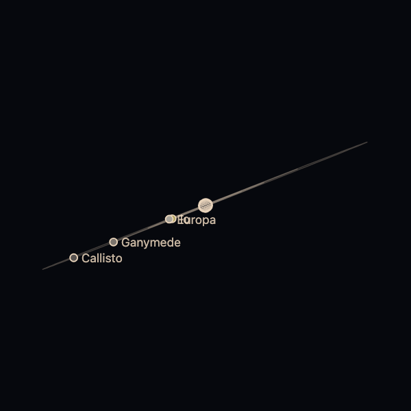

The embed page draws what its address says and fetches nothing but its own files, so it is safe to put in any page. The example was run in a browser by the package's tests.



```html
<!doctype html>
<html lang="en">
  <head>
    <meta charset="utf-8" />
    <meta name="viewport" content="width=device-width, initial-scale=1" />
    <title>Wakusei Planets in an iframe</title>
  </head>
  <body>
    <iframe
      src="https://johnmorrisdotca.github.io/wakusei-planets/embed.html?body=saturn&look=line"
      title="Saturn"
      width="420"
      height="420"
      loading="lazy"
      style="border: 0"
    ></iframe>
  </body>
</html>
```

The address takes these choices:

| Query | Meaning |
|---|---|
| `body` | which body, `jupiter` by default |
| `look` | `line` (the default), `realistic` or `painted`; the shaded looks need WebGL and fall back to the line drawing |
| `time` | `now` or an ISO date: the body as the Earth sees it then. A portrait when left out |
| `moons` | `1` draws the planet with its moons on their orbits |
| `turn` | degrees a second it turns by itself; still by default |
| `tilt`, `pitch`, `phase`, `meridian` | a portrait's pose, in degrees |
| `scale-to` | draw to scale with another body |

Give the frame a title. The embed page draws only when something changes, and nothing while it is out of sight.
