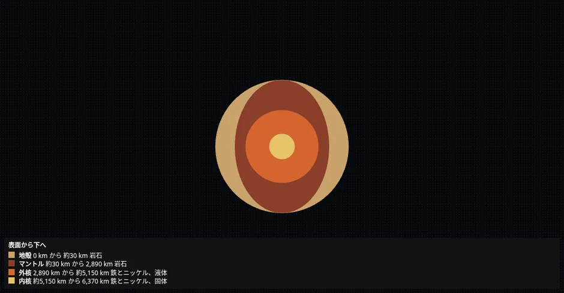
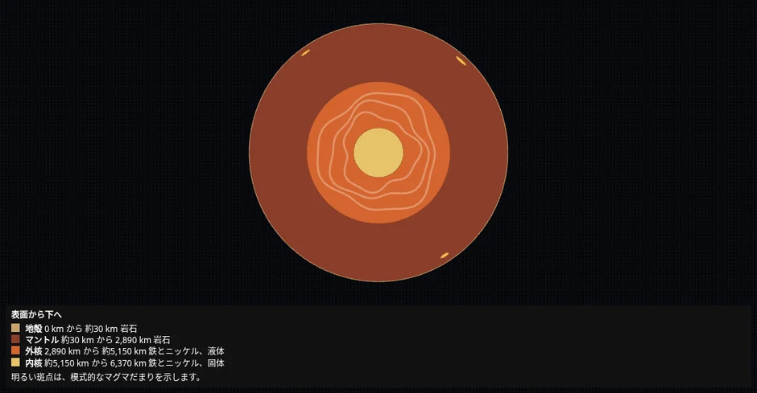

断面は必要なときにオンにします。属性を付けないか `cutaway="off"` にすると、天体は丸ごとのままです。凡例には層の名前、表面からの深さ、成分を表示します。深さはキロメートルで、有効数字3桁です。

例では先に `@johnmorrisdotca/wakusei-planets/element` を読み込みます。陰影つきの地球には `@johnmorrisdotca/wakusei-planets/earth` も読み込みます。`three` のインストールも必要です。詳しくは[見た目と天体](looks-and-bodies.md)を参照してください。

## 従来の断面

値を指定せずに `cutaway` を付けると、球の4分の1が開き、重なった殻が見えます。殻は真球で、天体を回しても縁の円は同心のままです。太陽は切れ目のない円盤で描きます。スマートフォンでは凡例が天体の下に並びます。

```html
<wakusei-body body="earth" look="realistic" lang="ja" cutaway></wakusei-body>
```



## 2D の断面

`look="line"` と `cutaway="half"` または `cutaway="quarter"` を組み合わせると、すべての層が同心円で見える平面の断面を描きます。WebGL は不要です。`half` か `quarter` を指定していて WebGL が使えない場合も、同じ断面を表示します。スマートフォンでは凡例が断面の下に並びます。

```html
<wakusei-body body="earth" look="line" lang="ja" cutaway="quarter"></wakusei-body>
```



## 3D の半分の断面

`half` を指定すると、球の上下を結ぶ軸の周りに180度開きます。天体を回しても断面はこちらを向きます。スマートフォンでは、球と断面全体が凡例の上に収まります。

```html
<wakusei-body body="earth" look="realistic" lang="ja" cutaway="half"></wakusei-body>
```


## 3D の4分の1の断面

`quarter` を指定すると、90度のくさび形に開き、2つの断面が見えます。天体を回して表面を見ている間も、開口部はこちらを向きます。スマートフォンでは2つの断面が凡例の上に収まります。

```html
<wakusei-body body="earth" look="realistic" lang="ja" cutaway="quarter"></wakusei-body>
```


## 断面の流れを動かす

`half` または `quarter` の断面に `cutaway-flow` を付けると、地球と月の液体の外核、木星の金属水素の流れを描きます。2D でも使えます。地球の表面近くの明るい点は、マグマだまりを模式的に示したものです。デモでは、図の上の「流れを再生」「流れを一時停止」ボタンで切り替えられます。自分のページでは属性を外すと止まります。天体が画面の外に出たときやタブが非表示のとき、動きを減らす設定が有効なときは、流れが止まります。

```html
<wakusei-body body="earth" look="realistic" lang="ja" cutaway="quarter" cutaway-flow></wakusei-body>
```


## 断面を表示できる天体

層の厚さは下に挙げた出典の値に従います。「約」は境界が概数であることを示します。従来の断面を選んだ場合、太陽は円盤で描きます。

| 天体 | 表示できる断面 | 出典 | 模式的な層の比率 |
|---|---|---|---|
| 地球 | 従来、2D、半分、4分の1 | [NASA 地球ファクトシート][earth-sheet]、[NASA Science 地球の解説][earth-facts] | いいえ |
| 火星 | 従来、2D、半分、4分の1 | [NASA 火星ファクトシート][mars-sheet] | いいえ |
| 月 | 従来、2D、半分、4分の1 | [NASA 月ファクトシート][moon-sheet]、[NASA Science 月の解説][moon-facts] | いいえ |
| 水星 | 従来、2D、半分、4分の1 | [NASA 水星ファクトシート][mercury-sheet]、[NASA Science 水星の解説][mercury-facts] | いいえ |
| 太陽 | 従来、2D、半分、4分の1 | [NASA 太陽ファクトシート][sun-sheet]、[NASA Science 太陽の解説][sun-facts]、[修正された太陽モデル S][sun-model] | いいえ |
| 木星 | 従来、2D、半分、4分の1 | [NASA 木星ファクトシート][jupiter-sheet]、[Militzer ほか (2022) のモデル A][jupiter-model] | いいえ |
| 土星 | 従来、2D、半分、4分の1 | [NASA 土星ファクトシート][saturn-sheet]、[NASA Science 土星の解説][saturn-facts]、[Mankovich と Fuller (2021)][saturn-model] | いいえ |
| 金星 | 従来、2D、半分、4分の1 | [Margot ら (2021) の2層モデル][venus-model] | いいえ |
| 天王星 | 従来、2D、半分、4分の1 | [Nettelmann ら (2013) の U2 モデル][ice-giant-model] | いいえ |
| 海王星 | 従来、2D、半分、4分の1 | [Nettelmann ら (2013) の N2b モデル][ice-giant-model] | いいえ |

以下の天体は、このパッケージが層の境界の出典を採用していないため、丸ごと描きます。断面を指定すると、そのことを凡例に表示します。イオ、エウロパ、ガニメデ、タイタンについて確認した NASA のファクトシートには、層の境界の数値がありません。

| 天体 | 表示できる断面 | 層の出典 | 模式的な層の比率 |
|---|---|---|---|
| 冥王星、ケレス、オルクス、ハウメア、クワオアー、マケマケ、ゴンゴン、エリス、セドナ | 丸ごと | — | — |
| ベンヌ、エロス、ベスタ、パラス、アロコス | 丸ごと | — | — |
| キロン、フォルス | 丸ごと | — | — |
| ハレー彗星 | 丸ごと | — | — |
| フォボス、ダイモス | 丸ごと | — | — |
| イオ、エウロパ、ガニメデ、カリスト、アマルテア、テーベ | 丸ごと | — | — |
| ミマス、エンケラドス、テティス、ディオネ、レア、タイタン、イアペトゥス、ハイペリオン、フェーベ、ヤヌス、エピメテウス、プロメテウス、パンドラ、アトラス、パン、ダフニス、ヘレネ、テレスト、カリプソ | 丸ごと | — | — |
| ミランダ、アリエル、ウンブリエル、ティタニア、オベロン | 丸ごと | — | — |
| プロテウス、ラリッサ、トリトン、ネレイド | 丸ごと | — | — |
| カロン、ニクス、ヒドラ、ステュクス、ケルベロス | 丸ごと | — | — |
| ヴァンス | 丸ごと | — | — |
| ヒイアカ、ナマカ | 丸ごと | — | — |
| ディスノミア | 丸ごと | — | — |

`interiorOf("earth")` から、地球の凡例が使う層のデータを取得できます。出典と確認日は [NOTICE.md](../../../NOTICE.md) に記載しています。

## 地球

体積平均半径は 6371 km、核の外側は 3485 km です (NASA の地球ファクトシート、2026-11-13 に読んだ)。内核の半径は約 1221 km で、鉄とニッケルの固体です。外核は鉄とニッケルの液体です。地殻は岩石で、陸では深さ約 30 km です。マントルは核とその地殻のあいだの岩石なので、その外側は平均半径から約 30 km を引いたところです。同じページは海底の地殻を約 5 km とも書いています。この断面が描く地殻は、陸の数値の1枚です。

| 層 | 表面からの深さ | 成分 |
|---|---|---|
| 地殻 | 0 km から 約30 km | 岩石 |
| マントル | 約30 km から 2,890 km | 岩石 |
| 外核 | 2,890 km から 約5,150 km | 鉄とニッケル、液体 |
| 内核 | 約5,150 km から 6,370 km | 鉄とニッケル、固体 |

## 火星

体積平均半径は 3389.5 km、核の半径は 1830 km です (NASA の火星ファクトシート、2026-11-13 に読んだ)。ページはどちらの成分も述べておらず、核の外側を分けてもいないので、凡例は「述べられていない」と書き、層は2枚です。

| 層 | 表面からの深さ | 成分 |
|---|---|---|
| 核の外側 | 0 km から 1,560 km | 述べられていない |
| 核 | 1,560 km から 3,390 km | 述べられていない |

## 月

体積平均半径は 1737.4 km です (NASA の月ファクトシート)。層は NASA Science の月の事実で、2026-11-26 に読みました。鉄を多く含む固体の内核は半径 240 km、液体の鉄の殻は厚さ 90 km (330 km のところに描く)、表側の地殻は厚さ約 40 km です。裏側は約 60 km まであり、こちらが描く地殻ではありません。ページは一部が溶けた層の名前を挙げ、厚さを述べていないので、その層だけの殻はありません。マントルは、ページがかんらん石と輝石だろうと書いている部分です。

| 層 | 表面からの深さ | 成分 |
|---|---|---|
| 地殻 | 0 km から 約40 km | 岩石 |
| マントル | 約40 km から 1,410 km | かんらん石と輝石 |
| 外核 | 1,410 km から 1,500 km | 鉄、液体 |
| 内核 | 1,500 km から 1,740 km | 鉄、固体 |

## 水星

体積平均半径は 2439.7 km です (NASA の水星ファクトシート)。NASA Science の水星の事実を 2026-11-26 に読むと、金属の核は半径約 2074 km で一部が溶けており、残りは岩石のマントルと地殻で、二つには分けてありません。同じページは、その殻の厚さを約 400 km とも書いています。この断面は、述べられた核の半径とファクトシートの半径を使うので、描く殻は 365.7 km です。

| 層 | 表面からの深さ | 成分 |
|---|---|---|
| マントルと地殻 | 0 km から 約366 km | 岩石 |
| 核 | 約366 km から 2,440 km | 金属、一部は溶けている |

## 太陽

NASA が示す体積平均半径は695,700 km、中心核の半径は約138,000 kmです。修正された太陽モデル S では、対流層の内側は半径の0.7127の位置にあります。断面図では、その割合をNASAの半径に当てはめています。中心核と対流層の間に放射層があります。[NASA 太陽ファクトシート][sun-sheet]、[NASA Science 太陽の解説][sun-facts]、[太陽モデル S のデータ][sun-model]。

| 層 | 表面からの深さ | 成分 |
|---|---|---|
| 対流層 | 0 km から 約200,000 km | 水素とヘリウム |
| 放射層 | 約200,000 km から 約558,000 km | 水素とヘリウム |
| 中心核 | 約558,000 km から 696,000 km | 水素がヘリウムに変わる |

## 木星

Militzer ほか 2022、"Juno Spacecraft Measurements of Jupiter's Gravity Imply a Dilute Core" (Planet. Sci. J.、doi 10.3847/PSJ/ac7ec8) のモデル A を 2026-11-26 に読みました。そのモデルの集まりでは、遷移層の内側は半径の 0.41 (0.03 の幅)、外側は 0.63 (0.01 の幅) です。同じモデルは、金属水素を 0.63 から 0.72、ヘリウムの雨を 0.72 から 0.83 に置きます。半径はファクトシートの 69911 km です。これは一つのモデルの境で、目で見た壁ではありません。

| 層 | 表面からの深さ | 成分 |
|---|---|---|
| 外層 | 0 km から 11,900 km | 水素とヘリウム |
| ヘリウムの雨 | 11,900 km から 19,600 km | ヘリウムが液滴になって沈む |
| 金属水素 | 19,600 km から 約25,900 km | 金属状の水素 |
| 遷移層 | 約25,900 km から 約41,200 km | 重元素が減っていく |
| 均質な内層 | 約41,200 km から 69,900 km | 重元素 18% |

## 土星

Mankovich と Fuller、2021、"A diffuse core in Saturn revealed by ring seismology" (Nature Astronomy、doi 10.1038/s41550-021-01448-3) を 2026-11-26 に読みました。境界のぼやけた核が、氷と岩石で、半径のおよそ 60% までのびます。半径はファクトシートの 58232 km です。外層は水素とヘリウムで、NASA Science の土星の事実によります。60% は論文の「およそ」なので、おおよそと印をつけます。

| 層 | 表面からの深さ | 成分 |
|---|---|---|
| 外層 | 0 km から 約23,300 km | 水素とヘリウム |
| 境界のぼやけた核 | 約23,300 km から 58,200 km | 氷と岩石が混ざっている |

## 金星

Margot らは慣性モーメントをもとに、半径6,051.8 kmの金星を2層に分けたモデルを示しています。このモデルによる核の半径は3,508 kmで、不確かさは約500 kmです。断面図は約3,500 kmを使います。Dumoulin らの潮汐モデルでは核の半径は2,900～3,450 kmです。[Margot ら (2021)][venus-model]、[Dumoulin ら (2017)][venus-tides]。

| 層 | 表面からの深さ | 成分 |
|---|---|---|
| マントル | 0 km から 約2,550 km | 岩石 |
| 核 | 約2,550 km から 6,050 km | 密度の高い物質 |

## 天王星と海王星

Nettelmann らの U2 モデルと N2b モデルでは、岩石の核を2つの層が取り囲みます。このモデルでは、重い成分を水で代表させています。図4の密度の段差から、核はどちらも半径の約0.15までと読み取れます。平均半径と外層の内側の境界は表2の値です。2つのモデルは自転と形に関して同じ種類の修正データを使います。[Nettelmann ら (2013) の表2と図4][ice-giant-model]。

| モデル | 平均半径 | 核の半径 | 外層の内側の境界 |
|---|---:|---:|---:|
| 天王星 U2 | 25,378 km | 約15% | 約75.7% |
| 海王星 N2b | 24,650 km | 約15% | 約60.5% |

[earth-sheet]: https://nssdc.gsfc.nasa.gov/planetary/factsheet/earthfact.html
[earth-facts]: https://science.nasa.gov/earth/facts/
[mars-sheet]: https://nssdc.gsfc.nasa.gov/planetary/factsheet/marsfact.html
[moon-sheet]: https://nssdc.gsfc.nasa.gov/planetary/factsheet/moonfact.html
[moon-facts]: https://science.nasa.gov/moon/facts/
[mercury-sheet]: https://nssdc.gsfc.nasa.gov/planetary/factsheet/mercuryfact.html
[mercury-facts]: https://science.nasa.gov/mercury/facts/
[sun-sheet]: https://nssdc.gsfc.nasa.gov/planetary/factsheet/sunfact.html
[sun-facts]: https://science.nasa.gov/sun/facts/
[jupiter-sheet]: https://nssdc.gsfc.nasa.gov/planetary/factsheet/jupiterfact.html
[jupiter-model]: https://doi.org/10.3847/PSJ/ac7ec8
[saturn-sheet]: https://nssdc.gsfc.nasa.gov/planetary/factsheet/saturnfact.html
[saturn-facts]: https://science.nasa.gov/saturn/facts/
[saturn-model]: https://doi.org/10.1038/s41550-021-01448-3
[sun-model]: https://users-phys.au.dk/jcd/solar_models/
[venus-model]: https://doi.org/10.1038/s41550-021-01339-7
[venus-tides]: https://doi.org/10.1002/2016JE005249
[ice-giant-model]: https://doi.org/10.1016/j.pss.2012.06.019
