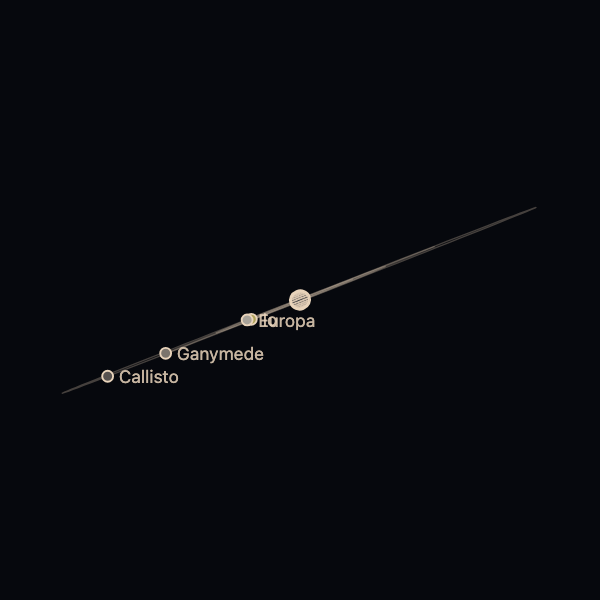

埋め込みページは、アドレスで言われたものを描くだけで、自分のファイル以外は取得しません。どのページに置いても安全です。この例は、パッケージのテストがブラウザーで動かしています。



```html
<!doctype html>
<html lang="en">
  <head>
    <meta charset="utf-8" />
    <meta name="viewport" content="width=device-width, initial-scale=1" />
    <title>Wakusei Planets in an iframe</title>
  </head>
  <body>
    <iframe
      src="https://johnmorrisdotca.github.io/wakusei-planets/embed.html?body=saturn&look=line"
      title="Saturn"
      width="420"
      height="420"
      loading="lazy"
      style="border: 0"
    ></iframe>
  </body>
</html>
```

アドレスで選べるもの:

| クエリ | 意味 |
|---|---|
| `body` | 天体。初期値は `jupiter` |
| `look` | `line` (初期値)、`realistic`、`painted`。陰影つきには WebGL が必要で、使えないときは線画になります |
| `time` | `now` か ISO の日時。その時刻に地球から見える姿。省くと肖像 |
| `moons` | `1` で、惑星と衛星を軌道つきで描きます |
| `turn` | 自分で回る速さ (度/秒)。初期値は止まっています |
| `tilt`、`pitch`、`phase`、`meridian` | 肖像の向き (度) |
| `scale-to` | ほかの天体と大きさを合わせます |

iframe には title を付けてください。埋め込みページは、何かが変わったときだけ描き、見えていないときは何も描きません。
