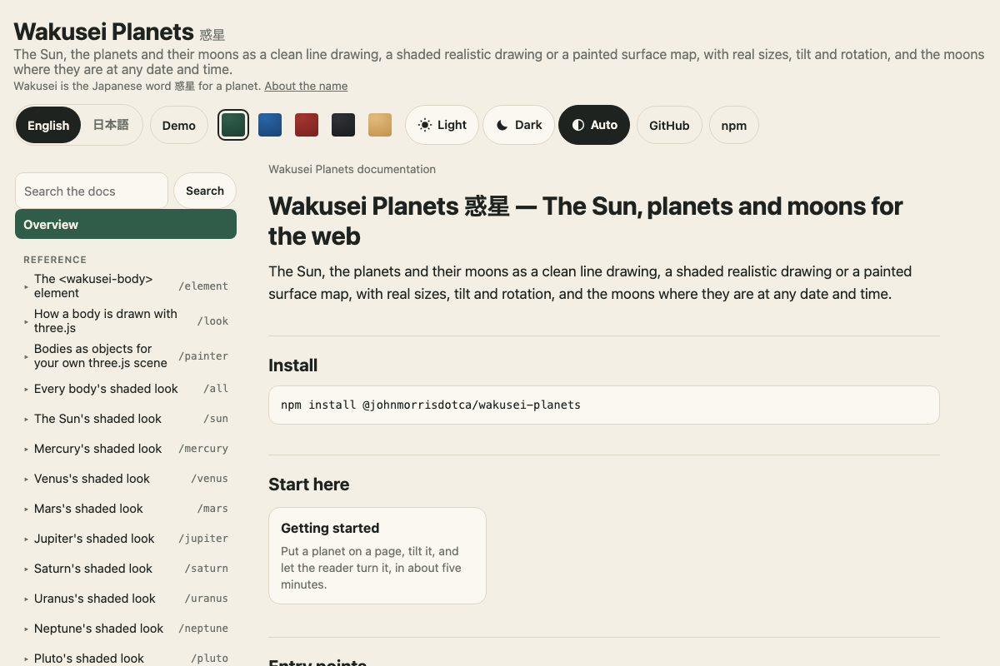

このガイドでは、土星をページに置いて、読む人が回す・傾ける・拡大できるようにします。必要なのはテキストエディターとブラウザーだけです。インストールは要りません。ページがCDNからパッケージを読み込みます。



## 1. 惑星のあるページ

`saturn.html` という名前で保存して開いてください。`<wakusei-body>` が天体で、その上のスクリプトがこのタグを動かします。

```html
<!doctype html>
<html lang="en">
  <head>
    <meta charset="utf-8" />
    <meta name="viewport" content="width=device-width, initial-scale=1" />
    <title>Wakusei Planets from jsDelivr</title>
    <script type="module" src="https://cdn.jsdelivr.net/npm/@johnmorrisdotca/wakusei-planets/element/+esm"></script>
  </head>
  <body>
    <wakusei-body body="saturn" look="line" size="320"></wakusei-body>
  </body>
</html>
```

`body` は天体の名前です (`sun`、`mercury`、`venus`、`earth`、`mars`、`jupiter`、`saturn`、`uranus`、`neptune`、`pluto`、準惑星の `ceres`、`orcus`、`haumea`、`quaoar`、`makemake`、`gonggong`、`eris`、`sedna`、`moon`、そして各惑星の衛星)。`look="line"` は輪郭だけの線画で、SVGなので、ほかには何も要りません。円盤は土星の自転軸の傾き (26.73度) のとおりに傾き、輪は北極の上から見たように開いています。`size` は幅 (ピクセル) です。

## 2. 読む人が回せるようにする

パッケージは絵を描くだけです。回す・傾ける・拡大する・つまむ・動かす・全体に戻すといった操作は、共通の [kazoku-ui](https://github.com/johnmorrisdotca/kazoku-ui) の操作部品が受け持ちます。部品を足して、その知らせを天体に渡すリスナーを1つ書きます。

```html
<!doctype html>
<html lang="en">
  <head>
    <meta charset="utf-8" />
    <meta name="viewport" content="width=device-width, initial-scale=1" />
    <title>Wakusei Planets with the shared controls</title>
    <script type="module">
      import "https://cdn.jsdelivr.net/npm/@johnmorrisdotca/kazoku-ui/view-controls/define/+esm";
      import "https://cdn.jsdelivr.net/npm/@johnmorrisdotca/wakusei-planets/element/+esm";

      const body = document.querySelector("wakusei-body");
      document.querySelector("kazoku-view-controls").addEventListener("kazoku-viewchange", (event) => {
        body.setView(event.detail);
      });
    </script>
  </head>
  <body>
    <div id="view" tabindex="0">
      <wakusei-body body="saturn" look="line" size="420"></wakusei-body>
    </div>
    <kazoku-view-controls for="view" address controls="advanced" tilt-max="90" speed="0"></kazoku-view-controls>
  </body>
</html>
```

`setView(view)` は操作部品のカメラを受け取ります。`yaw` は天体を自分の極のまわりに回し、`tilt` は極を手前や奥に傾け、`roll` は絵を視線のまわりに時計回りに回し、`zoom` は拡大・縮小し、`panX` と `panY` は絵を中央から CSS ピクセルの分だけ動かします。線画はすぐに描き直され、陰影つきの絵は共通のレンダラーが、動いている間だけ、1秒に30回までで描き直します。ポインターの下の表面はポインターについてくるので、ドラッグすると手の向きに地面が動きます。触れた点をポインターの下に留めるには、円盤の半径 (ピクセル) を操作部品に渡します: `controls.setAttribute("grab-radius", String(Math.round(body.discRadius)))` (`discRadius` は画面上の天体の円盤の半径で、要素の大きさや `scale-to` で変わります)。

## 3. 次に

- 実際の色と地形で陰影をつける: [見た目と天体](looks-and-bodies.md)
- 惑星の衛星を、ある日時の位置で見せる: [衛星と時間](moons-and-time.md)
- バンドラーやフレームワークで使う: [バンドラー](bundlers.md)、[フレームワーク](frameworks.md)
- 他人のページに、自分のスクリプトなしで出す: [iframeで埋め込む](embed-in-an-iframe.md)
- サーバーで描く、型を使う: [TypeScriptとNode](typescript-and-node.md)
- 表示されないとき: [困ったとき](troubleshooting.md)
