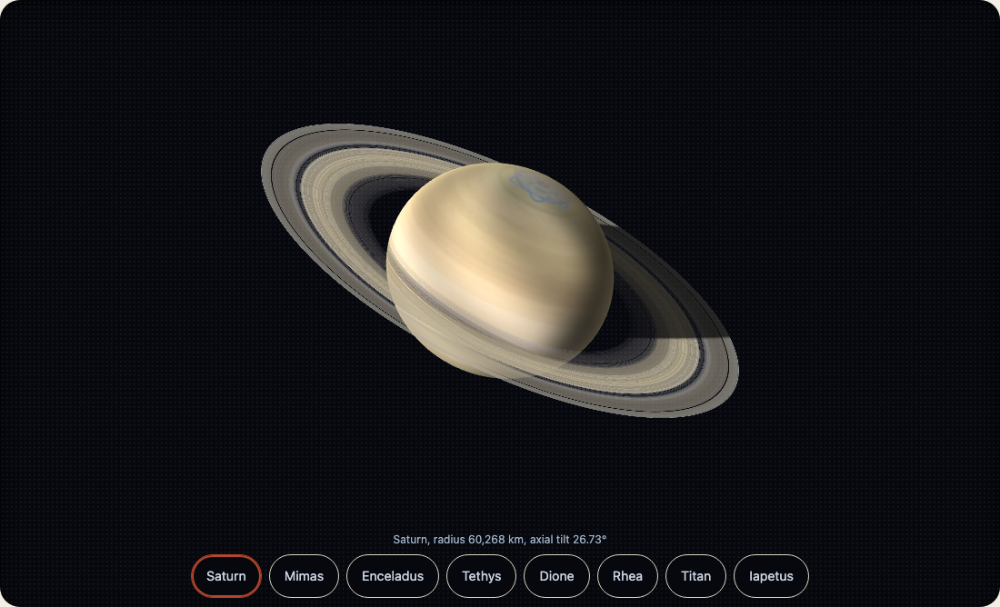
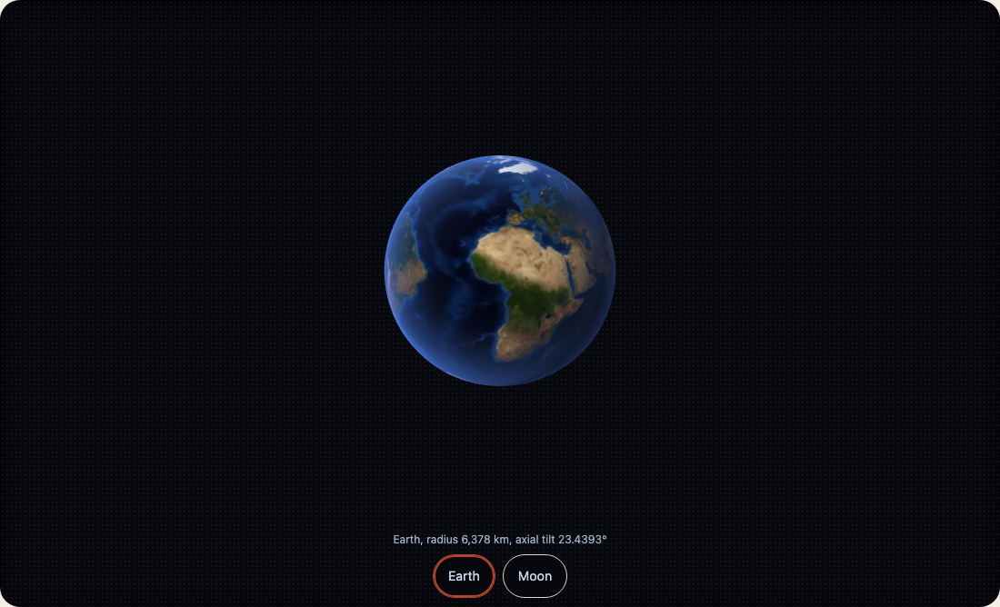
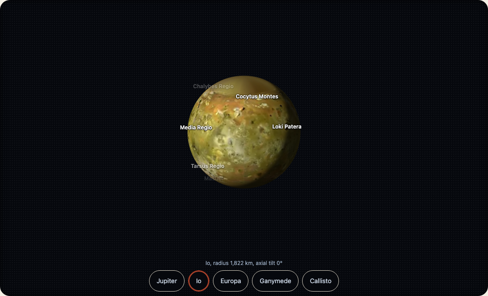
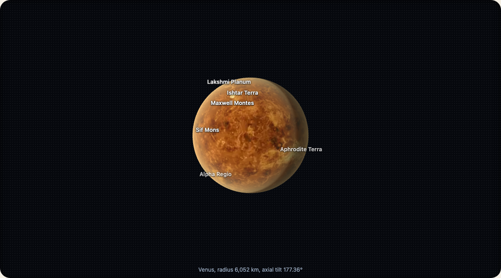

## 見た目

- `line`: 輪郭の線画 (SVG文字列)。ほかには何も要りません。
- `realistic`: 天体の表面地図を使い、太陽の側から光を当てます。`painted` は同じ地図で、古いページがそのまま動くように残しています。デモでは「リアル」ボタンでこの見た目を選びます。
- `illustrated`: 以前の `realistic` が描いていた絵で、絵の日本語名はイラストです。天体の色と表面の特徴から、シェーダーで計算します。既定の見た目ではありません。

イラストの火星では、クレーター目録の大きさと密度の統計をもとに、クレーターを計算して配置します。金星の淡い雲の帯は、紫外線で観測された Y 字形の雲を参考にしています。タイタンでは黄褐色のもやと外側の薄い青い層が、太陽が背後にあるときに明るく見えます。 [出典と測定値](../../../NOTICE.md#illustrated-mars-venus-and-titan)

小さい画像を先に描き、ズームすると、より細かい画像を読み込みます。画像を取得できないときは陰影つきの表示になります。[天体の表面地図](surface-maps.md) に、地図の出典、撮影範囲、描き足した地形をまとめています。









## 輪

木星、土星、天王星、海王星には輪があり、輪の帯ごとに光学的厚さ (光のさえぎりやすさ、輪の面に垂直な向きの値) `tau` が `BODIES.<惑星>.rings` に入っています。塵の輪と土星のB環とでは、値がまったく違います。値は NASA の NSSDCA の輪のファクトシートによるもので、シートは PDS Ring-Moon Systems Node に案内しています。読んだページと日付は NOTICE.md にあります。シートに範囲があるときは、その真ん中を使います。

| 輪 | tau |
|---|---|
| 木星の主環 | 5 x 10^-6 |
| 土星のB環、A環 | 1.45、0.7 |
| 天王星のイプシロン環 | 1.4 |
| 海王星のアダムス環 | 0.055 |

`tau` から描く不透明度へは、ひとつの決まりで変えます。`ringOpacity(tau)` は 1 - exp(-tau)、つまり真上から見たときに輪がさえぎる光の割合です。どの天体も同じ式で、惑星ごとに手で決めた数はありません。そのうえで下限をひとつ置きます。輪のいちばん濃いところが 0.12 に届かないときは、`ringStrip` が輪全体をそろえて持ち上げ、そこを 0.12 にします。輪はかろうじて見え、輪どうしの濃さの順は変わりません。この下限は描き方の選択で、物理ではありません。木星の輪は下限の細い線で、塵とゴサマー環はもっと薄く、土星は下限より濃いので変わりません。

## 天体ごとに別のエントリー

線画以外の見た目は、天体ごとのコードとデータなので、importも別です。`@johnmorrisdotca/wakusei-planets/saturn`、ガリレオ衛星は `/moons-jupiter` です。`/all` はすべてをimportします。エントリーをimportしていない天体は、その色の簡単な球として描かれます。

## 地球

地球も、ほかの天体と同じように描きます。realistic と painted は、どちらも NASA の Blue Marble の写真で、ほかの天体と同じ光と自転で描き、まわりに空気の縁をつけます（数字だけでは大陸の形を正直に描けないので、どちらの見た目も写真を使います）。`/all` に含まれます。ページの WebGL は1つを共有し、天体の並びでは止まった絵が出ます。線画は、ふだんはこのパッケージ自身の輪郭です。ページに [chikyu-earth](https://github.com/johnmorrisdotca/chikyu-earth) の国境つきの地球儀もあれば、そちらを使います。そのためには `@johnmorrisdotca/chikyu-earth` (任意の依存、0.10.0 以降) を入れて、`/earth` と一緒にその要素をimportしてください。

```js no-check
import "@johnmorrisdotca/chikyu-earth/element";
import "@johnmorrisdotca/wakusei-planets/earth";
```

`/earth` は chikyu-earth を自分ではimportしないので、入っていないプロジェクトでもビルドでき、輪郭を描きます。あとから chikyu-earth の要素がページに来たときは、地球はその地球儀に切り替わります。

chikyu-earth がなくても、線画の地球はこの輪郭のままで、ほかは何も変わりません。realistic と painted は chikyu-earth を必要としません。線画の地球を最初に描いてから2秒たっても要素が来ていないときは、ページのコンソールに `console.info` の1行を、1回だけ出して理由を伝えます。`wakusei-planets: the Earth's line look is drawn as a plain outline because chikyu-earth's element is not on the page. Import "@johnmorrisdotca/chikyu-earth/element" for the globe with the countries.`（地球の線画は、chikyu-earth の要素がページにないため、輪郭だけで描いています。国の入った地球儀にするには `@johnmorrisdotca/chikyu-earth/element` を import してください。）という英語の文です。警告ではなく情報として出すのは、省略できる peer を入れないのは選択だからです。`pnpm test:usage` は、chikyu-earth がない状態で `/earth` をビルドして輪郭を描き、この1行を確かめます。

### 陰影つきの見た目で chikyu-earth の realistic な地球を使う (オプトイン)

上の陰影つきの地球は、ほかの天体と同じように光を当てた写真です。chikyu-earth の `<chikyu-earth-realistic>` は、もっと多くを描きます。本物の太陽に合わせた昼と夜、都市の灯り、雲、大気、海に映る太陽のきらめきです。`realistic` と `painted` の地球にこれを使いたいページは、`earth-from="chikyu"` と書き、chikyu-earth の realistic の要素を import して、その画像の場所も指定します。

```html no-run
<script type="module">
  import "@johnmorrisdotca/chikyu-earth/realistic/element";
  import "@johnmorrisdotca/wakusei-planets/earth";
</script>
<wakusei-body body="earth" look="realistic" earth-from="chikyu" earth-texture-base="/chikyu-earth-textures/"></wakusei-body>
```

- **オプトインです。使うと、その天体は chikyu-earth のものになります。** このパッケージは chikyu-earth を自分では import しないので、ページがその要素を import するまで、この属性は何もしません。chikyu-earth が描く天体は、このパッケージの要素の代わりに chikyu-earth の要素が入るので、このパッケージが天体に加えるものは効きません。効かないのは、`tilt`、`pitch`、`phase`、衛星と輪、地球儀の上の場所と名前、共通の表示の操作、細かい地図のタイルです。効くのは `meridian` (真ん中の経度)、`time` (その日時の地球で止まります。`time` がなければ本物の太陽に合わせた時刻のままで、時間とともに進みます)、天体の大きさです。属性を書かなければ、これまでどおりこのパッケージの地球です。
- **`earth-texture-base`** は、chikyu-earth 自身の画像 (`day`、`night`、`clouds`、`water`。パッケージの `dist/textures/` にあります) のフォルダーです。要素の `texture-base` として渡します。指定しないと、要素は自分のスクリプトのそばを探しますが、バンドラーがスクリプトの場所を変えていることがあります。
- **WebGL コンテキストは1つではなく2つです。** それぞれのパッケージが kazoku-ui の共有レンダラーに自分のコンテキストを求めるので、このパッケージの陰影つきの天体と chikyu-earth の地球を並べたページには、コンテキストが2つあります (`e2e/earth-from-chikyu.demo.ts` で計測しています)。chikyu-earth が描く地球のために、このパッケージはコンテキストを作りません。chikyu-earth には共有できるレンダラーを渡せますが (`setSharedRenderer`。最初の要素がつながる前に呼びます)、このパッケージはまだレンダラーを公開も受け取りもしません。詳しくは [2つのパッケージ](two-packages.md) を見てください。
- **要素がないとき。** ページが頼んだのに要素がないときは、いつもどおりこのパッケージが地球を描き、2秒後にコンソールへ `console.info` の1行を1度だけ出します。`wakusei-planets: earth-from="chikyu" asks for chikyu-earth's realistic Earth, but its element is not on the page, so the Earth is drawn by this package. Import "@johnmorrisdotca/chikyu-earth/realistic/element" for its day and night, clouds and city lights.` という英語の文です。あとから要素が来たときは、その要素が天体を引き継ぎます。
- デモでは、アドレスに `earth-from=chikyu` を付けると、この地球が出ます (`?body=earth&look=realistic&earth-from=chikyu`)。

## 準惑星

冥王星のほかに、`ceres`、`orcus`、`haumea`、`quaoar`、`makemake`、`gonggong`、`eris`、`sedna` が、どの見た目でも描けます。位置は2026年6月のJPLの接触軌道要素から求めます (前後数年は合います)。大きさは NOTICE.md に挙げた論文の値です。ハウメア (1161 x 852 x 513 km、3.9時間で1回転) とクワオアーは、本当の細長い形で描きます。地図つきの見た目は、ケレス (探査機ドーンの地図) だけで、ケレスは realistic（デモの「リアル」）でもこの地図を使うので、どの見た目でも、オッカトル・クレーターの明るい点がある本物のケレスの姿になります。ほかの天体の表面は、発表されている色から描いた推定です。自転軸が測られていない天体は、軌道の極の向きにしています (どれかは NOTICE.md にあります)。ウェイウォト、シャンリュウ、S/2015 (136472) 1 は、日時つきの軌道が発表されていないので描きません。

## 小天体

さらに8つの天体があります。どれも `body` に自分の名前で指定でき、どの見た目でも描けます。小惑星の `bennu` (ベンヌ) と `eros` (エロス)、太陽系外縁天体の `arrokoth` (アロコス)、小惑星の `vesta` (ベスタ) と `pallas` (パラス)、ケンタウルス族 (木星と海王星のあいだにある、小さな氷の天体) の `chiron` (キロン) と `pholus` (フォルス)、そしてハレー彗星の `halley` です。種類は `asteroid`、`centaur`、`comet` です (`BODIES.vesta.kind`。一覧は `MINOR_IDS`)。ベスタ、パラス、キロン、フォルス、ハレー彗星は JPL Horizons の位置に合わせた表で置くので、ずれは1秒角以内です (表は精度ガイドにあります)。大きさ、自転軸、自転は小天体データベース (Small-Body Database) の値で、出典は NOTICE.md にあります。ベスタ (569 x 554 x 453 km、5.3時間で1回転) は探査機ドーンが測った形で、ドーンの写真地図を地図つきの見た目に使い、realistic でもこの地図を使います。パラスは横倒し (84度かたむいています) で、形は発表された大きさのとおりの、軸の長さが違う楕円体です。キロンとフォルスは点の光としてしか撮影されたことがなく、ハレー彗星の核を写した探査機の写真はこのパッケージでは使えません。そこでこの3つは数字から描きます (大きさ、形、色を合わせた岩に、架空のクレーターをつけたもの)。そのことは NOTICE.md にも書いてあります。自転軸が測られていない天体 (キロン、フォルス、ハレー彗星) は、軌道の極の向きにします。核がふらつきながら回るハレー彗星は、自転させずに描きます。ベンヌ、エロス、アロコスは、それぞれNASAが公開したモデルの形と、そのモデルの写真です（オサイリス・レックス、NEARシューメーカー、ニュー・ホライズンズ）。地球儀に地図を巻いたものではなく、その形の面そのものです。軌道は小天体データベースの楕円で、合わせた表ではありません。`?body=vesta` でデモをベスタで開き、`?body=eros` でエロスを開きます。

## 衛星

どの衛星も、`body` に自分の名前を渡せば、どの見た目でも描けます。デモには衛星の並びもあります。火星: `phobos`、`deimos`。木星: `io`、`europa`、`ganymede`、`callisto`、`amalthea`、`thebe`。土星: `mimas`、`enceladus`、`tethys`、`dione`、`rhea`、`titan`、`iapetus`、`pan`、`daphnis`、`atlas`、`prometheus`、`pandora`、`epimetheus`、`janus`、`telesto`、`calypso`、`helene`、`hyperion`、`phoebe`。天王星: `miranda`、`ariel`、`umbriel`、`titania`、`oberon`。海王星: `proteus`、`triton`、`nereid`、`larissa`。冥王星: `charon`、`styx`、`nix`、`kerberos`、`hydra`。オルクス: `vanth`。ハウメア: `hiiaka`、`namaka`。エリス: `dysnomia`。地球の衛星は `moon` です。`?body=io` でデモがイオで開きます。

このうち19個は、球や楕円体ではなく、本当の形で描きます。火星のフォボスとダイモス、木星のアマルテアとテーベ、土星のパン、ダフニス、アトラス、プロメテウス、パンドラ、エピメテウス、ヤヌス、テレスト、カリプソ、ヘレネ、ハイペリオン、フェーベ、海王星のラリッサとプロテウス、冥王星のニクスとヒドラです。ステュクスとケルベロスは、カタログの半径の球です。探査機が測った形は描かず、自転もしません。形は探査機の画像から作られたモデルから切り出します (フォボスとフェーベ: ガスケルのモデル。ダイモス: NASAの3Dモデル。土星の小さな衛星: ピーター・トーマスのモデルで、カッシーニの画像から。アマルテア、テーベ、ラリッサ、プロテウス: フィリップ・ストゥークのモデルで、ボイジャーの画像から。ニクスとヒドラ: サイモン・ポーターのモデルで、ニュー・ホライズンズの画像から。CC BY 4.0です)。数キロバイトの半径の表にして、その衛星を最初に描くときに読み込みます。そのため、フォボスのスティックニー・クレーターは、球に貼った絵ではなく、輪郭のへこみになります。フォボス、ダイモス、フェーベには、realistic の見た目で探査機の画像をつなぎ合わせたモザイクを貼ります。ほかの衛星には地図がないので、色は測った明るさから決め、クレーターはシェーダーが作ったもので、測ったものではありません。カードには `shapeNote(id, lang)` で、どちらかを書けます。「形も表面も探査機が測定したもの」、または「形は測定したもの。色は測定した明るさから」です (`shapeBasis(id)` は `"shape-and-map"`、`"shape"`、データだけで描く天体では `undefined` です)。自分の見た目にも、同じように `shape: () => Promise<ShapeTable>` を持たせられます。各モデルの出典、版、利用条件、そして確かでないことは NOTICE.md にあります。ダイモスのモデルには座標系の記載がないため、長さの順に軸を x、y、z に合わせています。ハイペリオンはでたらめに回るので、描く自転はありません。ストゥークのモデルは5度ごとの粗いものです。

## WebGLは1つ、必要なときだけ描く

線画以外の天体は、kazoku-ui の共通レンダラーを通じて、1ページで1つの WebGL を共有します。選ばれているものが動き、ほかは絵です。`live="hover"` にすると、指した天体に渡され、`live="off"` なら絵だけです。何も変わらないときは何も描かず、アニメーションフレームも頼みません。動いている間も1秒に30回まで、キャンバスは1辺4096ピクセル・600万ピクセルまでに抑え、要素が消えるときはすべて解放します。見えていないとき、タブが隠れているときは描かず、WebGL が失われても自動で戻ります。

## 本当の大きさ

`scale-to="jupiter"` で、木星に対する本当の大きさで描きます。`radiusKm`、`tiltDeg`、`rotationHours` は `BODIES` にあります。
