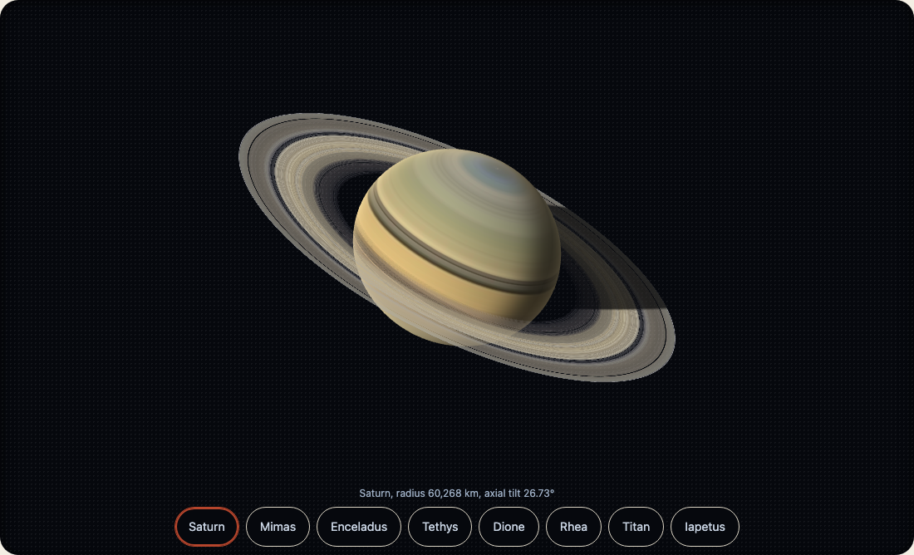
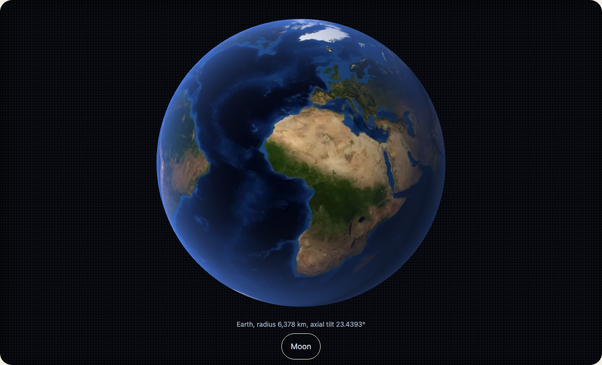
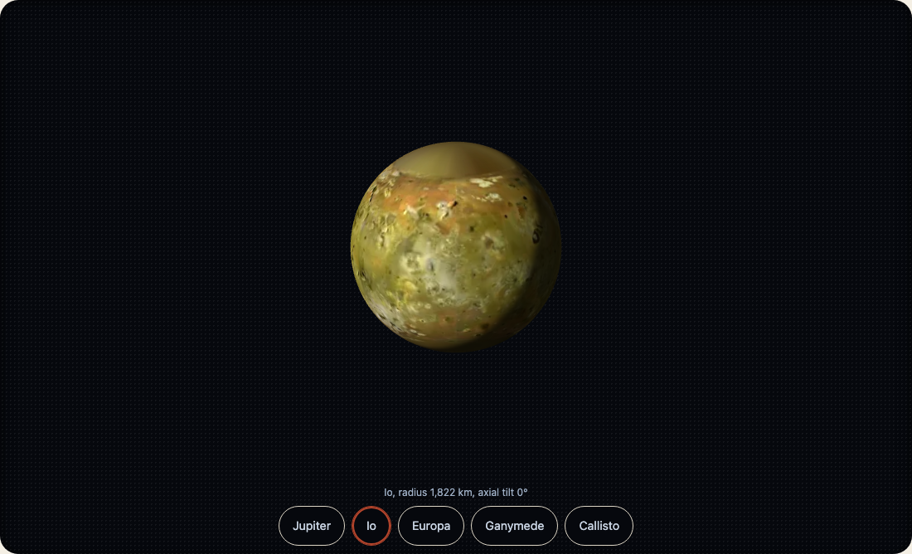
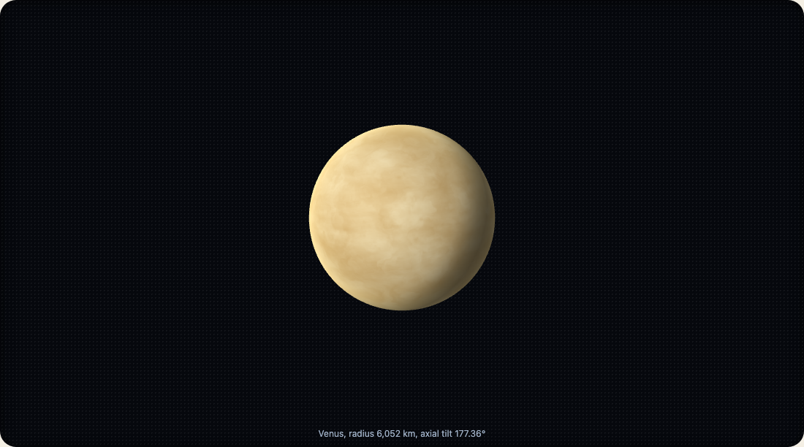

## 見た目

- `line`: 輪郭の線画 (SVG文字列)。ほかには何も要りません。
- `realistic`: 天体の実際の色と地形から three.js で描く、陰影つきの球。太陽の側から光が当たります。画像は取得せず、表面はシェーダーで計算します。
- `painted`: NASA・USGS・JPL の公有の画像から作った、太陽、水星から冥王星までの惑星、ケレス、月、ガリレオ衛星の4つ、ミマス、エンケラドス、テティス、ディオネ、レア、タイタン、イアペトゥス、トリトン、カロンの、本物の表面の地図です。土星の輪は、カッシーニが撮った輪の写真から作っています。最初は小さい画像を描き、拡大すると、より細かい画像を取得します。取得できなければ陰影つきのままです。土星・天王星・海王星・太陽は全体の地図がないので、写真1枚から作っています (NOTICE.md に書いてあります)。

## 天体ごとに別のエントリー

陰影つきの見た目は、天体ごとのコードとデータなので、importも別です。`@johnmorrisdotca/wakusei-planets/saturn`、ガリレオ衛星は `/moons-jupiter` です。`/all` はすべてをimportします。エントリーをimportしていない天体は、その色の簡単な球として描かれます。

## 地球

地球も、ほかの天体と同じように描きます。陰影つきと表面の地図のどちらも、NASA の Blue Marble の画像を、ほかの天体と同じ光と自転で描き、まわりに空気の縁をつけます (数字だけから本物らしい地球は描けないので、どちらの見た目も画像を使います)。`/all` に含まれます。ページの WebGL は1つを共有し、天体の並びでは止まった絵が出ます。線画は [chikyu-earth](https://github.com/johnmorrisdotca/chikyu-earth) の国境つきの線の地球儀です。`@johnmorrisdotca/chikyu-earth` (任意の依存、0.10.0 以降) を入れて `/earth` をimportしてください。入っていないときの線画は、このパッケージ自身の輪郭です。

## 準惑星

冥王星のほかに、`ceres`、`orcus`、`haumea`、`quaoar`、`makemake`、`gonggong`、`eris`、`sedna` が、どの見た目でも描けます。位置は2026年6月のJPLの接触軌道要素から求めます (前後数年は合います)。大きさは NOTICE.md に挙げた論文の値です。ハウメア (1161 x 852 x 513 km、3.9時間で1回転) とクワオアーは、本当の細長い形で描きます。地図つきの見た目は、ケレス (探査機ドーンの地図) だけです。ほかの天体の表面は、発表されている色から描いた推定です。自転軸が測られていない天体は、軌道の極の向きにしています (どれかは NOTICE.md にあります)。ウェイウォト、シャンリュウ、S/2015 (136472) 1 は、日時つきの軌道が発表されていないので描きません。

## 衛星

どの衛星も、`body` に自分の名前を渡せば、どの見た目でも描けます。デモには衛星の並びもあります。火星: `phobos`、`deimos`。木星: `io`、`europa`、`ganymede`、`callisto`。土星: `mimas`、`enceladus`、`tethys`、`dione`、`rhea`、`titan`、`iapetus`。天王星: `miranda`、`ariel`、`umbriel`、`titania`、`oberon`。海王星: `proteus`、`triton`、`nereid`。冥王星: `charon`、`nix`、`hydra`。オルクス: `vanth`。ハウメア: `hiiaka`、`namaka`。エリス: `dysnomia`。地球の衛星は `moon` です。`?body=io` でデモがイオで開きます。

## WebGLは1つ、必要なときだけ描く

陰影つきの天体は、kazoku-ui の共通レンダラーを通じて、1ページで1つの WebGL を共有します。選ばれているものが動き、ほかは絵です。`live="hover"` にすると、指した天体に渡され、`live="off"` なら絵だけです。何も変わらないときは何も描かず、アニメーションフレームも頼みません。動いている間も1秒に30回まで、キャンバスは1辺4096ピクセル・600万ピクセルまでに抑え、要素が消えるときはすべて解放します。見えていないとき、タブが隠れているときは描かず、WebGL が失われても自動で戻ります。

## 本当の大きさ

`scale-to="jupiter"` で、木星に対する本当の大きさで描きます。`radiusKm`、`tiltDeg`、`rotationHours` は `BODIES` にあります。
