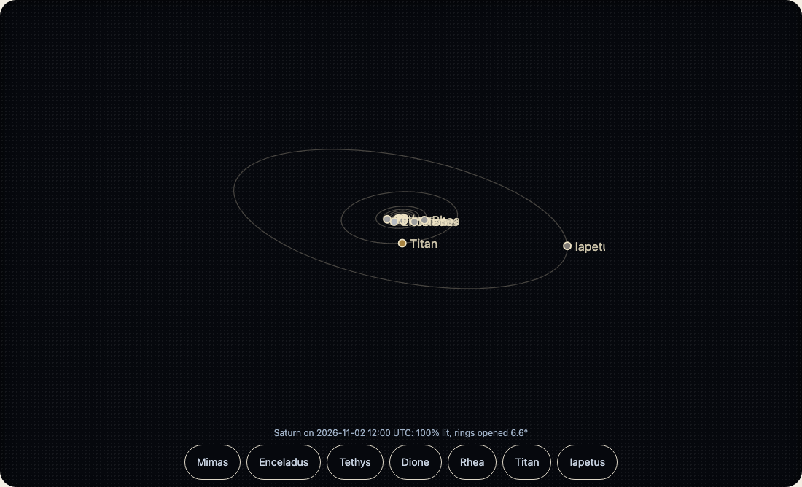

惑星に `moons` を付けて `time` を与えると、その時刻に地球から見える位置に、衛星を軌道つきで描きます。軌道は JPL Horizons の位置に合わせてあり、ほとんどの衛星で、軌道上の誤差は 1度か 2度以内です。画面で見る衛星の大きさと同じくらいです。衛星ごとの数字は[精度](accuracy.md)にあります。



```html
<wakusei-body body="jupiter" look="line" moons time="2026-11-02T12:00:00Z"></wakusei-body>
```

`rate` は、現実の1秒で進む模擬の秒数です。`rate="3600"` なら、1秒で1時間進みます。`rate="0"` は時計を止めます。止まっているあいだは何も描き直しません。デモでは、ファミリー共通の再生バー (kazoku-ui の `<kazoku-replay-bar>`) で動かします。「再生」は表示している日時から時計を進め、「一時停止」は止め、「もとの日付へ」は選んだ日付に戻します。速さは `1 3600 86400` で、実際の時間の何倍かを表します (下の「時計が進むあいだの日付の見せ方」を見てください)。「回す」ボタンには、1秒に14度の0.5×、1×、2×のボタンが別にあります。動かしているときは、空の計算を約1秒に1回だけ全部行い、その間は衛星をそこから進めます。1コマの費用は、ベクトルを数回回すだけです。`range` は絵が届く範囲 (惑星の半径が単位) で、それより遠い衛星は描きません。

`time="now"` は時計に従います。`moons` なしで `time` だけ付けると、その日の見え方になります。輪の開き、満ち欠け、こちらを向いている面です。

## 時計が進むあいだの日付の見せ方

日付の欄があるページは、時計がどの日時まで進んだかを知る必要があります。`<wakusei-body>` (`time` か `moons` があるとき) と `<wakusei-space>` は、`detail: { time, running }` をつけた `wakusei-timechange` を送ります。`time` は、いま見せている時刻で、1970年からのミリ秒です。

- 時計が進んでいるあいだ (`rate` や `speed` が0でないとき) は、絵を何回描き直しても1秒に4回まで送ります (実際の時間の速さなら1秒に1回)。タブが表示されているときだけです。日付の欄は絵の下にあることが多いので、絵が画面に見えていなくても送ります。
- 時計が止まったときは、`running: false` をつけて1回だけ送ります。だから、ページは止まった日時をアドレスに書けます。
- ページ自身が `time` を設定したときは送りません。`wakusei-body` の `time` プロパティは、いつでもいま見せている時刻を返します。

```ts no-run
import "@johnmorrisdotca/wakusei-planets/element";

const body = document.querySelector("wakusei-body")!;
const box = document.querySelector<HTMLInputElement>("#when")!;
body.addEventListener("wakusei-timechange", (event) => {
  const { time, running } = (event as CustomEvent<{ time: number; running: boolean }>).detail;
  // 欄は時計について行きますが、読む人が入力しているあいだは書き換えません
  if (document.activeElement !== box) box.value = new Date(time).toISOString().slice(0, 16);
  if (!running) history.replaceState(null, "", `?t=${new Date(time).toISOString()}`);
});
```

「再生」「一時停止」「もとの日付へ」は、kazoku-ui の `<kazoku-replay-bar>` のボタンです。「再生」は `rate` (や `speed`) を選んだ速さにし、「一時停止」は0にします。そのとき、進んだ日時を先に `time` に書くので、時計は止まった所から続きます。「もとの日付へ」は、読む人が選んだ日付に `time` を戻して止めます。デモは、アドレスに `play=on` と `speed` を残し、時計が止まったときと読む人がページを離れるときは、日付 (`t`) も残します。動きを減らす設定の人では、「再生」は止めたままにします。
