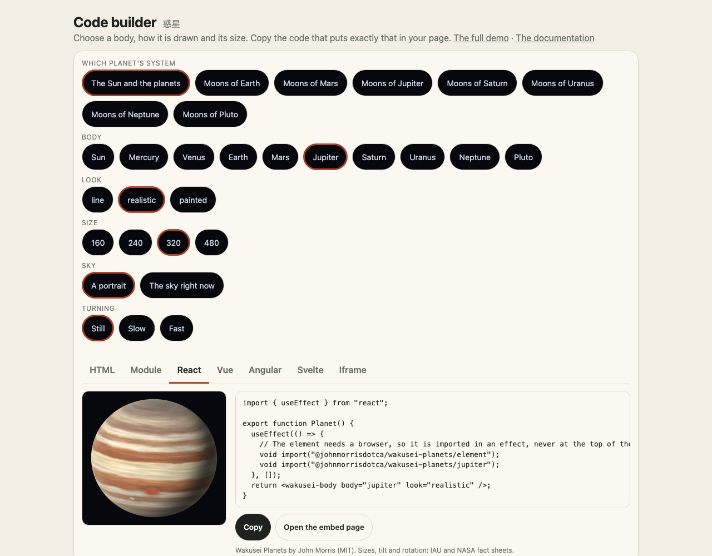

デモの「自分のページに入れる」は、設定画面です。上で天体を決めます (どの天体か、見た目、空と日時、衛星、回すかどうか)。大きさを選んで、ページの作り方を選びます。選ぶたびに、コードと横の絵が変わります。絵につけるクレジットはコードの下に出ます。



同じ文章は `embedCode` で作れるので、自分のページでも同じ選択画面を作れます。

```ts
import { embedCode, embedCredit, EMBED_KINDS } from "@johnmorrisdotca/wakusei-planets";

const choices = { body: "jupiter", look: "realistic", time: "now", moons: true, size: 320 } as const;
for (const kind of EMBED_KINDS) console.log(kind, embedCode(choices, kind).length);
console.log(embedCredit(choices));
```

- `html`: jsDelivr のスクリプトタグ (要素と、線画以外のときはその天体の陰影つきの見た目) と要素です。
- `module`: 同じ import と、要素を作る数行です。
- `react`、`vue`、`angular`、`svelte`: ブラウザに入ってから要素を import するコンポーネントです (サーバーでは import しません)。
- `iframe`: デモの `embed.html` に、選択をアドレスで渡します。スクリプトを置けないページ向けです。

どのコードもテストしています。React のコンポーネントはビルドして描画し、Vue と Svelte のコンポーネントはコンパイルし、Angular のテンプレートと ES モジュールは構文を調べ、iframe のアドレスは埋め込みページと同じ読み方で確かめます。衛星には日時が必要なので、`moons` は `time` があるときだけ書きます。衛星の陰影つきの見た目は惑星のファイル (`moons-jupiter`) に入っていて、コードが自動で import します。
