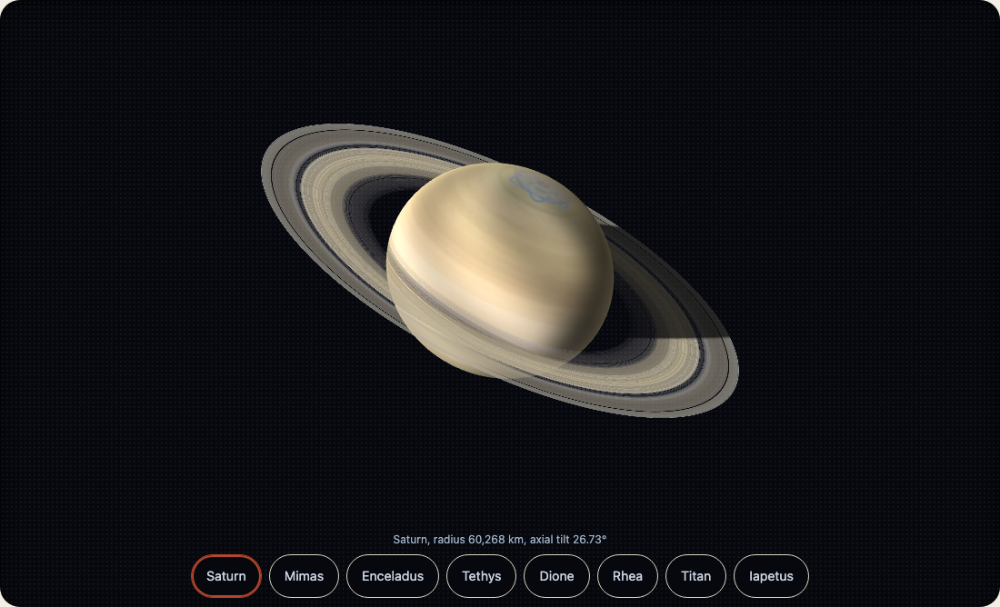
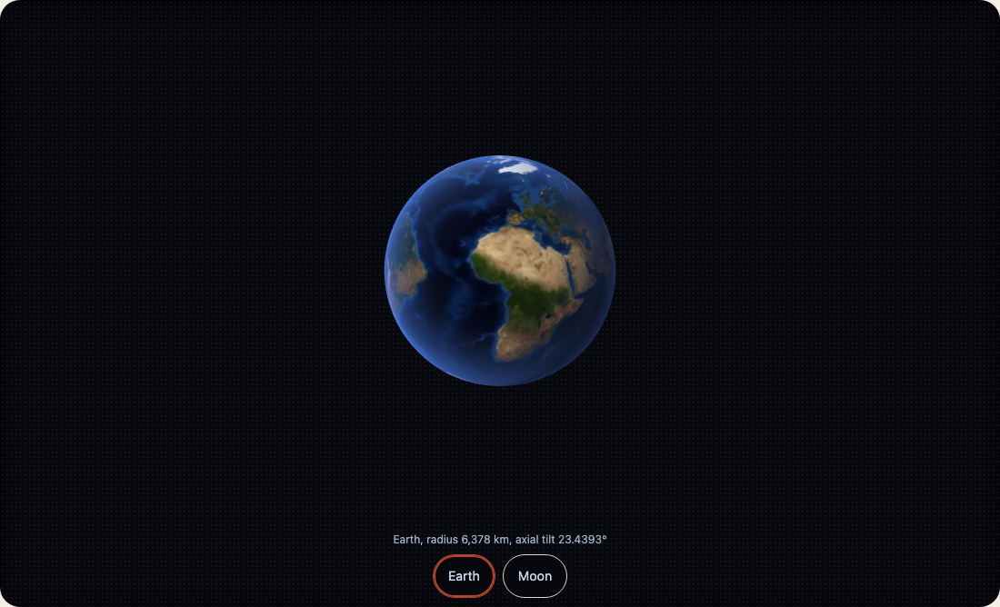
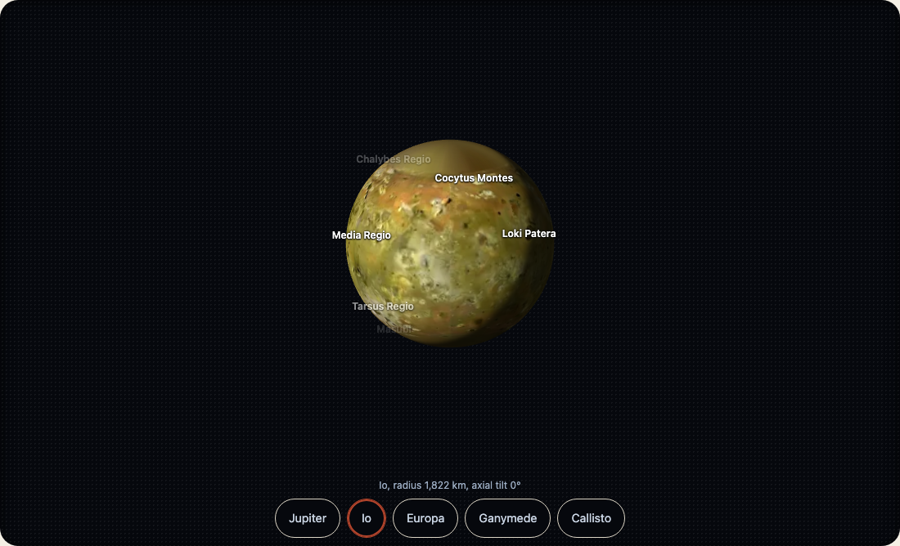
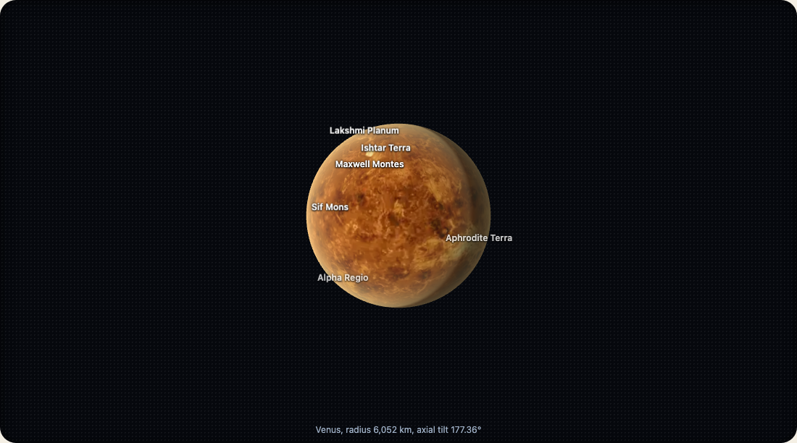

## The looks

- `line`: a clean outline drawing, an SVG string. It needs nothing else.
- `realistic`: the surface maps, lit from the Sun's side. `painted` is the same maps, kept so an older page still works. The demo's one button for them is Realistic.
- `illustrated`: the shaded drawing `realistic` used to be, worked out in the shader from the body's colours and features. It is not a default.

A small picture loads first, and a sharper one is fetched on close zoom. If a picture cannot be fetched, the shaded look stays. [Surface maps](surface-maps.md) lists each mapped body’s source, photographed coverage and reconstructed areas.









## Rings

Jupiter, Saturn, Uranus and Neptune have rings, and each band of a ring has a normal optical depth, `tau`, in `BODIES.<planet>.rings` (how much light the band stops when it is seen from above; a dusty ring and Saturn's B ring are worlds apart). The values are from NASA's NSSDCA ring fact sheets, which send on to the PDS Ring-Moon Systems Node; NOTICE.md names each page and the day it was read. Where a sheet gives a range, the middle of it is used.

| Ring | tau |
|---|---|
| Jupiter's main ring | 5 x 10^-6 |
| Saturn's B ring, A ring | 1.45, 0.7 |
| Uranus's epsilon ring | 1.4 |
| Neptune's Adams ring | 0.055 |

One rule turns `tau` into the opacity a band is drawn with: `ringOpacity(tau)` is 1 - exp(-tau), the share of light a ring stops when it is seen from above. It is the same for every body; no number is set by hand for a planet. Then one floor: when the most opaque point of a system's rings would come out under 0.12, `ringStrip` scales the whole system up until that point reaches 0.12, so it stays just visible and its parts keep their order. The floor is a drawing choice, not physics. Jupiter's ring is a faint line at the floor, with its dust and gossamer fainter still; Saturn is above the floor and is not changed.

## Each body is its own entry point

A shaded look is code and data for one body, so each has its own import: `@johnmorrisdotca/wakusei-planets/saturn`, and `/moons-jupiter` for the Galilean moons. `/all` imports every one. A body whose entry has not been imported is drawn as a plain lit ball in its colour.

## The Earth

The Earth is drawn like every other body. Its realistic and painted looks are NASA's Blue Marble picture, lit and turned like the rest, with a rim of air (a shaded Earth cannot honestly be worked out from numbers, so both looks use the picture); `/all` includes it. They share the page's one WebGL context and have stills in a row of bodies. Its line look is this package's own outline unless the page also has [chikyu-earth](https://github.com/johnmorrisdotca/chikyu-earth)'s globe with the countries. For that, install `@johnmorrisdotca/chikyu-earth` (an optional peer, 0.10.0 or later) and import its element beside `/earth`:

```js no-check
import "@johnmorrisdotca/chikyu-earth/element";
import "@johnmorrisdotca/wakusei-planets/earth";
```

`/earth` never imports chikyu-earth itself, so a project without it builds and draws the outline; when chikyu-earth's element arrives later on the page, the Earth switches to its globe.

Without chikyu-earth the line Earth is that plain outline, and nothing else changes: the realistic and painted looks never need it. If the element has still not come two seconds after the first line Earth is drawn, the page's console gets one `console.info` line, once, saying why: `wakusei-planets: the Earth's line look is drawn as a plain outline because chikyu-earth's element is not on the page. Import "@johnmorrisdotca/chikyu-earth/element" for the globe with the countries.` It is an information line, not a warning, because leaving out an optional peer is a choice. `pnpm test:usage` builds `/earth` with chikyu-earth missing, draws the outline and checks that line.

### chikyu-earth's realistic Earth in the shaded looks (opt in)

The shaded Earth above is a picture, lit like the other bodies. chikyu-earth's `<chikyu-earth-realistic>` draws more: the day and night sides by the real Sun, city lights, clouds, the air and the Sun's glint on the sea. A page that wants it for the Earth in the `realistic` and `painted` looks says so with `earth-from="chikyu"`, and imports chikyu-earth's realistic element and where its pictures are:

```html no-run
<script type="module">
  import "@johnmorrisdotca/chikyu-earth/realistic/element";
  import "@johnmorrisdotca/wakusei-planets/earth";
</script>
<wakusei-body body="earth" look="realistic" earth-from="chikyu" earth-texture-base="/chikyu-earth-textures/"></wakusei-body>
```

- **It is opt in, and the body is then chikyu-earth's.** This package never imports chikyu-earth, so the attribute does nothing until the page has imported the element. A body drawn by chikyu-earth is its element in this one's place, so what this package adds to a body does not apply to it: tilt, pitch and phase, moons and rings, places and names on the globe, the shared view controls and the finer tiles. It follows `meridian` (the longitude in the middle), `time` (the Earth at that date, held; with no `time` it keeps the real Sun's time and moves with it) and the body's size. Leave the attribute out and the Earth is this package's, as before.
- **`earth-texture-base`** is the folder of chikyu-earth's own pictures (`day`, `night`, `clouds` and `water`, in `dist/textures/` of the package), given to the element as its `texture-base`. Without it the element looks beside its own script, which a bundler may have moved.
- **Two WebGL contexts, not one.** Each package asks kazoku-ui's shared renderer for its own context, so a page that shows a shaded body of this package beside chikyu-earth's Earth has two (measured by `e2e/earth-from-chikyu.demo.ts`); this package makes none for the Earth chikyu-earth draws. chikyu-earth can be given a renderer to share (`setSharedRenderer`, before its first element connects), but this package does not yet export or take one: see [the two packages](two-packages.md).
- **Without the element.** When the page asked for it and the element is not there, the Earth is drawn by this package as usual, and the page's console gets one `console.info` line, once, two seconds after: `wakusei-planets: earth-from="chikyu" asks for chikyu-earth's realistic Earth, but its element is not on the page, so the Earth is drawn by this package. Import "@johnmorrisdotca/chikyu-earth/realistic/element" for its day and night, clouds and city lights.` An element that arrives later takes the body over.
- The demo opens it with `earth-from=chikyu` in the address (`?body=earth&look=realistic&earth-from=chikyu`).

## The dwarf planets

Besides Pluto: `ceres`, `orcus`, `haumea`, `quaoar`, `makemake`, `gonggong`, `eris` and `sedna`, in every look. They are put where they are from JPL's osculating elements of June 2026 (good for a few years either side), their sizes are from the papers NOTICE.md lists, Haumea (1161 x 852 x 513 km, turning every 3.9 hours) and Quaoar are drawn as the long shapes they are, and only Ceres has a painted map (Dawn's), which its realistic look draws too, so Ceres looks like Ceres, with the bright spots of Occator crater, in every look. The surface of the others is drawn from their published colours, so it is an estimate, and where a pole has not been measured it is taken along the orbit's pole: NOTICE.md says which. The moons Weywot, Xiangliu and S/2015 (136472) 1 are not drawn because no orbit with a published phase exists.

## The minor bodies

Eight more, each with its own name for `body` in every look: the asteroids Bennu and Eros and the Kuiper belt object Arrokoth (`bennu`, `eros`, `arrokoth`), the asteroids `vesta` and `pallas`, the centaurs `chiron` and `pholus` (small icy bodies between Jupiter and Neptune) and Halley's comet, `halley`. Their kind is `asteroid`, `centaur` or `comet` (`BODIES.vesta.kind`, `MINOR_IDS` lists them). Vesta, Pallas, Chiron, Pholus and Halley are put where JPL Horizons has them on a fitted table, within an arc-second (the accuracy guide has the table); sizes, poles and spins are the Small-Body Database's, with the sources in NOTICE.md. Vesta (569 x 554 x 453 km, turning every 5.3 hours) is the long shape Dawn measured and has Dawn's own photomap as its painted look, which its realistic look draws too. Pallas is on its side (tipped 84 degrees) and the long shape its published sizes give. Nobody has photographed Chiron or Pholus as more than a point of light, and Halley's nucleus was photographed by a probe whose pictures this package may not use, so those three are drawn from their numbers (a rock of the right size, shape and colour with invented craters), and NOTICE.md says so. Where a pole has not been measured (Chiron, Pholus, Halley) the spin axis is taken along the orbit's pole, and Halley, whose nucleus tumbles, is drawn still. Bennu, Eros and Arrokoth are each the mesh and the picture NASA published of them (OSIRIS-REx, NEAR Shoemaker and New Horizons): the faces of that model, not a map wrapped on a globe, and each orbit is the Small-Body Database ellipse rather than a fitted table. `?body=vesta` opens the demo on Vesta, and `?body=eros` opens it on Eros.

## The moons

Every moon has its own name for `body`, in every look and in the demo's row of moons: Mars: `phobos`, `deimos`. Jupiter: `io`, `europa`, `ganymede`, `callisto`, `amalthea`, `thebe`. Saturn: `mimas`, `enceladus`, `tethys`, `dione`, `rhea`, `titan`, `iapetus`, `pan`, `daphnis`, `atlas`, `prometheus`, `pandora`, `epimetheus`, `janus`, `telesto`, `calypso`, `helene`, `hyperion`, `phoebe`. Uranus: `miranda`, `ariel`, `umbriel`, `titania`, `oberon`. Neptune: `proteus`, `triton`, `nereid`, `larissa`. Pluto: `charon`, `styx`, `nix`, `kerberos`, `hydra`. Orcus: `vanth`. Haumea: `hiiaka`, `namaka`. Eris: `dysnomia`. The Earth's is `moon`. `?body=io` opens the demo on Io.

Nineteen of them are drawn with their real shape, not a sphere or an ellipsoid: Phobos and Deimos (Mars), Amalthea and Thebe (Jupiter), Saturn's Pan, Daphnis, Atlas, Prometheus, Pandora, Epimetheus, Janus, Telesto, Calypso, Helene, Hyperion and Phoebe, Larissa and Proteus (Neptune) and Nix and Hydra (Pluto). Styx and Kerberos are spheres of the catalogue's radius: no spacecraft shape is drawn, and they do not turn. The shape is cut from a model a spacecraft's pictures made (Phobos and Phoebe: Gaskell's; Deimos: NASA's 3D model; Saturn's small moons: Peter Thomas's, from Cassini; Amalthea, Thebe, Larissa and Proteus: Philip Stooke's, from Voyager; Nix and Hydra: Simon Porter's, from New Horizons, CC BY 4.0) into a table of radii of a few kilobytes that loads the first time the moon is drawn, so Phobos's Stickney crater is a dent in the outline and not a picture on a ball. Phobos, Deimos and Phoebe wear a mosaic of spacecraft images in the realistic look; the others have no map, so their colour is the one their measured brightness gives, with craters worked out by the shader and not measured. A card can say which with `shapeNote(id, lang)`: "shape and surface measured by spacecraft", or "shape measured; colour from its measured brightness" (`shapeBasis(id)` is `"shape-and-map"`, `"shape"` or `undefined` for a body drawn from its facts alone). A look of your own can carry `shape: () => Promise<ShapeTable>` the same way. NOTICE.md has each model's source, version and terms, and what is not certain: the frame of Deimos's model is not stated, so its axes are put along x, y and z by their length; Hyperion tumbles, so its drawn spin is none; Stooke's models are coarse (5 degrees).

## One WebGL context, drawn on demand

Every shaded body on a page shares one WebGL context through kazoku-ui's shared renderer. The body in focus is live and the others show pictures: set `live="hover"` to give the context to whichever one the reader points at, `live="off"` for pictures only. Nothing is drawn while nothing changes, no animation frame is asked for while the page is at rest, a moving picture is drawn at most thirty times a second, the canvas is held to 4096 pixels a side and six million pixels, and everything is freed when the element leaves. A body that is out of sight or in a hidden tab is not drawn, and a lost WebGL context comes back by itself.

## Real sizes

`scale-to="jupiter"` draws a body at its real size relative to Jupiter. The body's `radiusKm`, `tiltDeg` and `rotationHours` are in `BODIES`.
