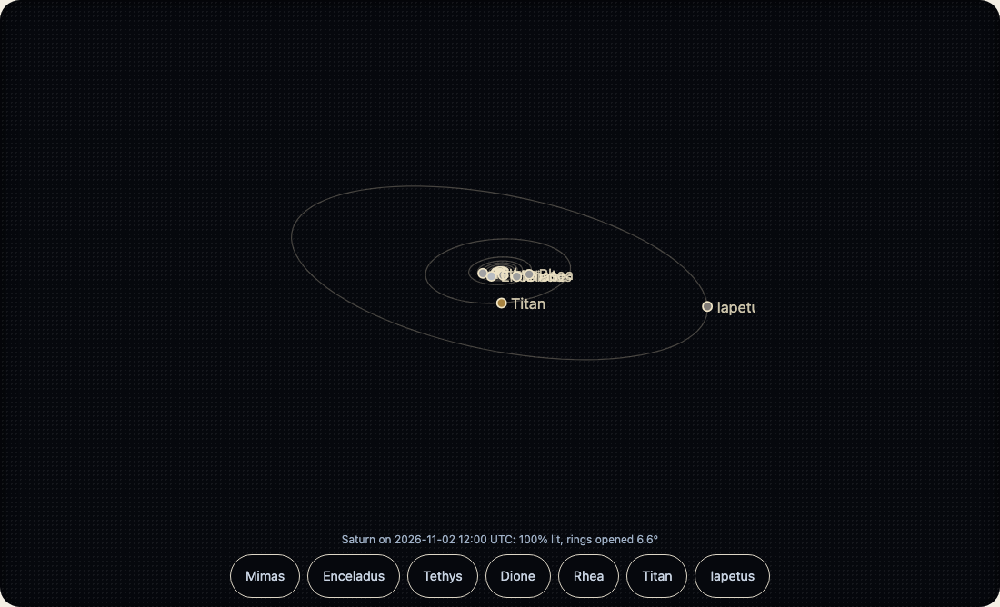

Add `moons` to a planet and give it a `time`: the moons are drawn on their orbits where they are then, as the Earth sees them. Their orbits are fitted to JPL Horizons' own positions, and are within a degree or two on the orbit for almost every moon, which is the width of a moon's own picture on a screen. [Accuracy](accuracy.md) has the number for each moon.



```html
<wakusei-body body="jupiter" look="line" moons time="2026-11-02T12:00:00Z"></wakusei-body>
```

`rate` is simulated seconds for each real second: `rate="3600"` is an hour a second. `rate="0"` holds the clock, and a held picture draws nothing. The demo runs it with the family's replay bar (kazoku-ui's `<kazoku-replay-bar>`): Play runs the clock from the date shown, Pause holds it, Back returns to the date chosen, and the speeds are `1 3600 86400`, read as multiples of real time (see "Showing the date while time runs" below); its Turn button has its own 0.5×, 1× and 2× of 14 degrees a second. A moving system works out the sky in full about once a second and carries the moons forward from there, so a frame costs a few turns of a vector, not an ephemeris. `range` is how far the picture reaches, in planet radii; moons beyond it are left out.

`time="now"` follows the clock. A planet with a `time` and no `moons` is drawn as it looks that day: its rings opened as far as they are, its phase, the face turned toward us.

## Showing the date while time runs

A page that has a date box needs to know the date the clock has reached. `<wakusei-body>` (with a `time` or `moons`) and `<wakusei-space>` send `wakusei-timechange` with `detail: { time, running }`, `time` being the moment shown in milliseconds since 1970:

- While the clock runs (`rate` or `speed` not 0) it is sent four times a second at most, however fast the picture is drawn (once a second at real time), and only while the tab is shown (the date box is often below the picture, so the picture need not be on screen).
- When the clock holds, it is sent once with `running: false`, so a page writes the date it stopped on into its address.
- It is not sent for a `time` the page sets itself, and `wakusei-body`'s `time` property reads the moment shown at any moment.
- The speed is kept on a slow machine too. Time follows the page's own clock, not the frames drawn: at `86400` a day passes for every real second whether the machine draws 60 frames a second or 5, `<wakusei-space>`'s `time` reads the moment now, and a picture drawn late shows the moment it is drawn at. A slow machine sends the event later and the date moves in bigger steps; it never runs slower. There is no cap on a long gap: a tab that was hidden, or a laptop that slept, finds the date where the speed would have taken it.

```ts no-run
import "@johnmorrisdotca/wakusei-planets/element";

const body = document.querySelector("wakusei-body")!;
const box = document.querySelector<HTMLInputElement>("#when")!;
body.addEventListener("wakusei-timechange", (event) => {
  const { time, running } = (event as CustomEvent<{ time: number; running: boolean }>).detail;
  // the box follows the clock, but never while the reader is typing in it
  if (document.activeElement !== box) box.value = new Date(time).toISOString().slice(0, 16);
  if (!running) history.replaceState(null, "", `?t=${new Date(time).toISOString()}`);
});
```

Play, Pause and Back are kazoku-ui's `<kazoku-replay-bar>`: Play sets `rate` (or `speed`) to the chosen speed and Pause sets it to 0, after writing the date reached into `time` so the clock goes on from where it was. Back sets `time` to the date the reader chose and holds it. The demo keeps `play=on` and `speed` in its address, and the date (`t`) when the clock stops or the reader leaves. A reader who prefers reduced motion gets Play left off.
