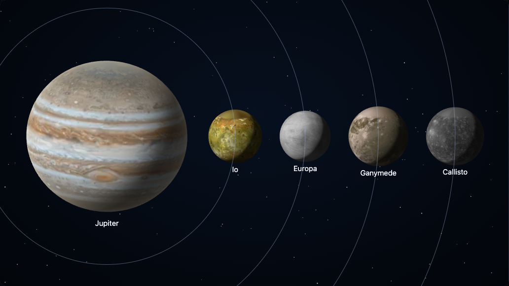

[The portrait builder](https://johnmorrisdotca.github.io/wakusei-planets/portrait.html) puts any bodies of the solar system in one picture: the Sun, the planets, Pluto, the other dwarf planets and any of the moons. Every body is drawn in the same WebGL scene, so the page still holds one WebGL context however many bodies are in it.



## Choosing and arranging

Pick bodies on the **Bodies** tab (a button for each; press it again to take the body out), or start from a preset: a family photo, the gas giants, Jupiter and the Galileans, the Earth and the Moon to scale. A chosen body is drawn at the front and has its own controls under the picture: its place in the order (front to back), its size, its lean and how far you look over its pole, and whether it turns by itself.

The **Arrange** tab has two layouts.

- **Auto-fit** places and sizes the bodies for you, always fitting them all in. Choose a row, an arc (a gentle curve, like a group photograph), a grid or **true orbit distance** (each moon as far from its planet, and each planet from the Sun, as it really is, with the orbits drawn; with a date, where they are then, seen from above); sizes are **true scale** (every size true to the others, so small bodies can be dots) or **readable** (squeezed together so the smallest can be seen). With the moons on **round their planet**, a planet's moons go in a line beside it, nearest first, each with its orbit ring. Dragging a body changes its place in the order.
- **Manual** keeps every body where you put it and the size you gave it. Drag a body to move it: it snaps to the middle and the edges of the others, and a guide line shows where (hold Alt to switch the snap off). Drag empty space to move the view; Centre and Fit all bring the bodies back. The wheel over the view zooms it about the pointer, and Shift with the wheel over a body sizes it. On a touch screen, pinch a body to size it.

Choosing Manual keeps every body where Auto-fit had put it. Auto-fit puts the layout back.

## Turning a body

Choose the **Turn** tool (or hold Shift while you drag): dragging turns the surface under your finger, so the surface follows the pointer, to the right when you drag right and up when you drag up. The arrow keys agree. A body can also turn by itself, still, slowly or fast, always the way the body really turns (a planet's surface goes from left to right as the Earth's does).

## Light, sky and look

The **Look** tab chooses how the bodies are drawn (line, realistic or painted), the background (black, stars, a gradient or clear), and where the Sun is: one direction for the whole picture, a compass angle and how far toward you. Shadows let one body shade another from the Sun, as in an eclipse, and are easiest to see with the Sun low and to the side. Names and orbit rings can be switched off. **Sky at a date** turns each body as the Earth sees it on that date, with its real pole.

## Keys

Arrow keys move the chosen body, or turn it with the Turn tool. `[` and `]` size it, Page Up and Page Down move it forward and back in the order, Home and End send it to the back and front, Delete takes it out and Ctrl+Z (Command+Z) undoes, Ctrl+Shift+Z redoes. In Auto-fit the left and right arrows change the order.

## Keeping and sharing a scene

The scene is kept in the address, as `?scene=...`, so a link is the picture. The **Share** tab writes the code for it in every way a page is made (plain HTML, an ES module, React, Vue, Angular, Svelte, an iframe), saves a PNG, saves an SVG, and copies the link. The SVG of a line scene is all vector. For the shaded looks, the bodies are a picture inside the SVG, with the background, the orbit rings and the names as vector.

```html
<script type="module" src="https://cdn.jsdelivr.net/npm/@johnmorrisdotca/wakusei-planets/portrait/+esm"></script>
<script type="module" src="https://cdn.jsdelivr.net/npm/@johnmorrisdotca/wakusei-planets/all/+esm"></script>

<wakusei-portrait scene="look:painted~jupiter_0_0_0.3_0~io_0_0_0.1_0"></wakusei-portrait>
```

`encodeScene` and `decodeScene` turn a scene into that text and back, `addBody` and `layoutPortrait` make and place one in code, and `portraitCode` writes the page code the builder shows.

## Performance

One WebGL context for the whole scene, however many bodies. Nothing is drawn while the picture is at rest. While something moves it is drawn thirty times a second at most, and while it is out of sight, in a hidden tab or when the reader prefers reduced motion, nothing moves. A body's picture is fetched at the size it needs, and given back when the body shrinks or leaves. The freeze test plays twelve bodies in one scene and fails on a draw at rest, more than one context, graphics memory that grows, or a canvas over its budget.
