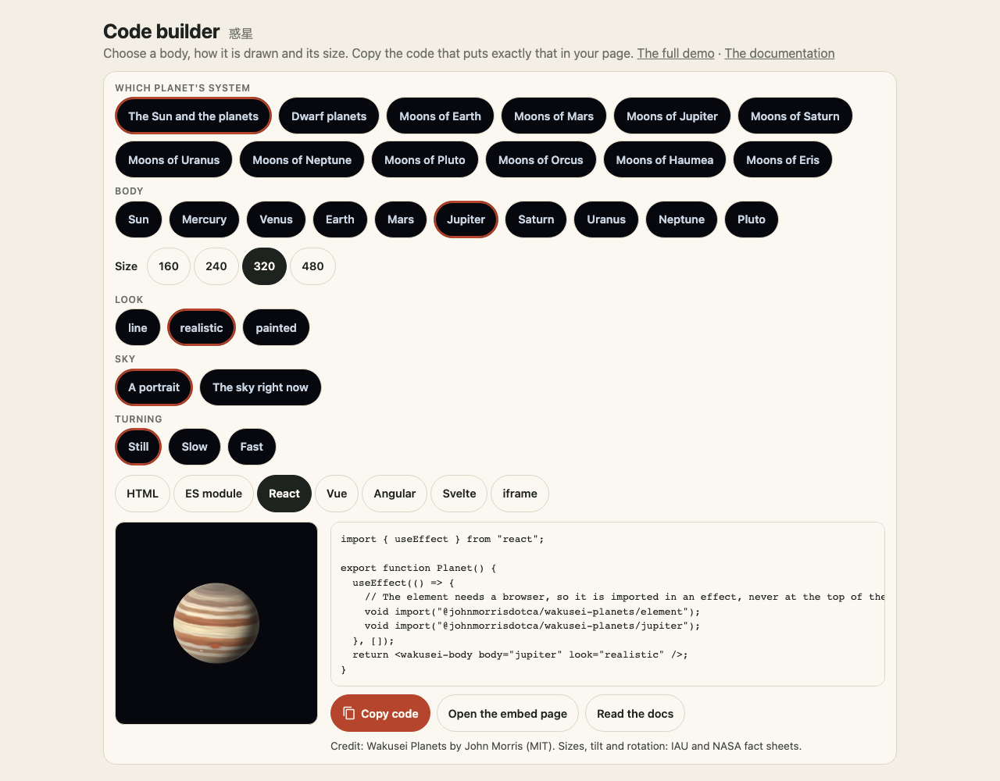

The demo's "Put it in your page" section is a configurator, and it is the family's shared panel, kazoku-ui's `<kazoku-embed-panel>` ([its guide](https://github.com/johnmorrisdotca/kazoku-ui/blob/main/docs/guides/embed-panel.md)): a compact picker for the body, a size, a tab for each way a page is made, the picture, Copy code, Open the embed page, Read the docs and the credit line. Set up the body above it (which body, its look, the sky and date, the moons, whether it turns), choose a size, then pick how your page is made. The code and the picture beside it change with every choice, and the credits that go with the picture are under the code. The [code builder](https://johnmorrisdotca.github.io/wakusei-planets/builder.html) is the same panel with the body, look, sky and turning choices inside it, and the [portrait builder](portrait-builder.md)'s Share tab is the same panel for a scene (it has no size and no picture of its own, because the portrait is on the page above it), with Save PNG, Save SVG and Copy link beside Copy code.



The same text is made by `embedCode`, so a page of your own can offer the same choice:

```ts
import { embedCode, embedCredit, EMBED_KINDS } from "@johnmorrisdotca/wakusei-planets";

const choices = { body: "jupiter", look: "realistic", time: "now", moons: true, size: 320 } as const;
for (const kind of EMBED_KINDS) console.log(kind, embedCode(choices, kind).length);
console.log(embedCredit(choices));
```

- `html`: script tags from jsDelivr (the element, and the body's own shaded look when the look is not a line drawing) and the element.
- `module`: the same imports and a few lines that make the element.
- `react`, `vue`, `angular`, `svelte`: a component that imports the element once it is in a browser, never on a server.
- `iframe`: the demo's `embed.html` with the choices in its address, for a page with no scripts.

Every snippet is tested: the package's tests build the React component and render it, compile the Vue and Svelte components, parse the Angular template and the ES module, and read the iframe's address the way the embed page does. Moons need a date, so `moons` is written only with a `time`. A moon's shaded look is in its planet's file (`moons-jupiter`), which the snippet imports for you.

`embedCredit(choices)` names the surface picture of that body when the look is `realistic` or `painted`, from `PICTURE_CREDITS`. A CC BY 4.0 map names its author, the licence and the changes. A public-domain map does not. `lang: "ja"` writes the same line in Japanese. A line drawing names no picture.
